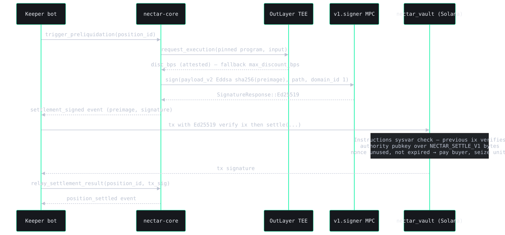

# Nectar Labs: committed buyers, higher limits

> **Testnet software for the NEAR Hackathon (development closes 2026-11-14 23:59 UTC). The collateral is a mock token (`nvdax-mock`) standing in for tokenized equities (xStocks / Opening Bell). No mainnet, no real funds. Gates (docs/EVIDENCE.md): G1, G2, G3 PASS (P0) · G4 OutLayer PASS · G6 1Click depth PASS · G5 oracle FALLBACK (disclosed): owner oracle in use · G8 copilot PASS (fixture) · v7: G1 (v7) PASS, G10 PASS (open items), G12 Base toolchain PASS on a local fork of Base Sepolia (not Base Sepolia, D-026) · after the 2026-11-11 security fix wave (D-027, [SECURITY.md](SECURITY.md)) the verifier re-ran on contract `2.2.1-v7`: G11 PASS, G1 gas-row check on 2.2.1 PASS on re-check (67 of 67 change methods, recorded in a677689; the first run failed on one owner setter without a row), G2b nectar-core-v2 deploy PASS, G7 Solana + signer round trip PASS, G14 x402 PASS (chain claims; HTTP 402 → 200 run by the verifier, recorded in 2e16f9b, and again on HEAD with the guarded demo agent, recorded in a677689), G13 Base round trip PASS on the local fork · latest G3b and G9 runs, with commit and result: docs/EVIDENCE.md §G3b / §G9. The hosted demo below runs release 4 (commit c95cd0c; production acceptance on the custom hosts PASS, docs/EVIDENCE.md §"WO-34 production (custom hosts)"). Not audited.**

Lenders cap LTV on tokenized stocks because DEX exit liquidity is revocable. Nectar Labs makes exit liquidity
*committed*. Market makers escrow time-locked quotes (Pappus) on NEAR. Borrowers get a higher limit
(Cramér) for a premium that pays the buyers. Pre-liquidation then sells to the committed buyer at a bounded discount instead of a DEX:
`B_c = min(LTV_c·V_c, (1−h_c)(Q_c+R_c+D_c))` (PRD §4.2, decision D-009).

## Hosted demo (NEAR testnet, mock collateral)
Production runs release 4, commit c95cd0c, deployed 2026-11-13 ~02:00Z with Kunal's approval (HUMAN_HANDOFF H-DEPLOY; Vercel web
dpl_Bm1uwQcX…, docs dpl_DpqAmb6…). The verifier's acceptance on the custom hosts: PASS, 8 of 8 items (docs/EVIDENCE.md §"WO-34 production
(custom hosts)", 2026-11-13T02:05Z–02:40Z). If production is redeployed later, that release and its result get their own block in §"WO-34 production".
Hosted until at least 2026-11-25 (`site.hosted_until` in `packages/config/config.yaml`). Hosts: `site.production_hosts` in the same file;
nectarlabs.io is on Vercel DNS (FACTS F-458). What the acceptance run shows: https://status.nectarlabs.io serves the status page, and
https://nectarlabs.io/status and https://testnet.nectarlabs.io/status redirect (308) there. The 56 docs pages answer at the root of
https://docs.nectarlabs.io, and an old `/docs/<path>` URL redirects (308) to `/<path>` with the query kept. The "Get test assets" button is on
https://testnet.nectarlabs.io/borrow (mock assets, no value; not on the Site or Status hosts). The 5 earlier vercel.app hosts redirect (308) to the
custom hosts with path and query kept.
| What | URL | Host | Notes |
| --- | --- | --- | --- |
| Site | https://nectarlabs.io | Vercel | landing, about, security, changelog, legal pages; any other path redirects (308) to the app |
| App | https://testnet.nectarlabs.io | Vercel | borrow, quotes, Feed, Notes, console; NEAR testnet only, mock NVDAx and mock USDC |
| Docs | https://docs.nectarlabs.io | Vercel (docs project) | this repo's `apps/docs-site`, pages at the host root; `/docs/<path>` redirects (308) to `/<path>` |
| Status | https://status.nectarlabs.io | Vercel (web app) | status page; https://nectarlabs.io/status and https://testnet.nectarlabs.io/status redirect (308) here |
| Feed REST | https://feed-production-2f2776c9.up.railway.app (e.g. `/health`) | Railway | read-only, no keys. Snapshots come from nectar-core-v2 views. **Contract events from block 277503800 on only.** Since WO-71 (merge 37dfec9) the Feed accepts nectar event versions `1.0.0` and `2.0.0` (v2 adds only fields the Feed does not read, evidence/WO-71/fields.md), indexes `settled_reserve`, and `/health` adds `indexer_cursor` and `indexer_lag_blocks`. The hosted Feed was redeployed from 37dfec9 on 2026-11-13 at 12:10Z (Railway deploy d2861e5f) with a fresh database, `FEED_INDEXER=neardata` (FastNear key, HUMAN_HANDOFF H-NEARDATA) and `FEED_START_BLOCK` 277503800. At 12:11:32Z it indexed blocks 277503800–277503899 with 1 event (the 11:28Z `oracle_updated`, block 277503817); the indexer lag fell from 4151 to 0 blocks by 12:27Z (evidence/ops/feed-v2-reindex-20261113T121107Z.log; orchestrator run, no verifier record). Events before block 277503800 (earlier borrows and settlements) are not in the hosted Feed. `/health` can read ok false for a few seconds (3 s freshness window at `FEED_POLL_MS` 1000, docs/FINAL_REPORT.md). The local x402 server with `FEED_URL` set to the redeployed Feed answered the paid CSV export 402 → 200 with 112 rows at 2026-11-13T12:28Z (tx [8bXCY34S…](https://testnet.nearblocks.io/txns/8bXCY34SVYv5b7vJ4GLfWkbJtQdqbSSBJsrzPCE75XRk), evidence/ops/x402-paid-download-20261113T122853Z.log; orchestrator run, no verifier record). CORS allows the Site, App and Status origins and refuses others (EVIDENCE §"WO-34 production (custom hosts)" item 7) |

Not hosted: the keeper and the x402 facilitator run on the operator's machine, with keys in the OS keychain or `0600` files under `~/.nectar/`.
x402 is never hosted because its relayer needs a full-access key (D-031); a hosted keeper waits on H-KEYS. Settlement triggers and remote-leg relays
therefore run only while the operator runs the keeper.
Checks: the orchestrator's public smoke test on the first deploy (2026-11-12 ~13:35Z) passed (evidence/WO-34/prod-smoke-20261112T133529Z.log: 28 app routes and 56 docs pages + 6 assets,
0 failures; host redirects, HSTS and CSP present, no noindex; Chrome on the docs: 0 failed requests, 0 console errors). The verifier's production acceptance runs
(one block per deployed release, with its result) are in docs/EVIDENCE.md §"WO-34 production"; earlier releases were checked on the platform
hosts, release 4 on the custom hosts (§"WO-34 production (custom hosts)"). No wallet has signed a borrow on the
hosted app yet (docs/DEMO_SCRIPT.md "Real-wallet borrow on the hosted app"). All tokens are mocks with no value. Test assets: the mock tokens
have a capped public `faucet_mint` since 2026-11-12 (5 NVDAx / 500 USDC per claim, 1 h cooldown, 3 claims per account; `faucet` in config.yaml;
evidence/rollout/mockft-faucet-20261112T200937Z.log). Its "Get test assets" button is deployed on https://testnet.nectarlabs.io/borrow;
the verifier checked it without a wallet (connect prompt; EVIDENCE §"WO-34 production (custom hosts)" item 4).

## Live on testnet (ids from `packages/config/config.yaml`; evidence in docs/EVIDENCE.md §G2b, §G7, §G14 and `evidence/`)
The current contract is `nectar-core-v2.nectar.testnet` (v7, deployed beside v1, D-018), now at `2.2.1-v7` after the 2026-11-11 security fix wave (D-027; findings, fixes and what remains in [SECURITY.md](SECURITY.md)). On 2026-11-11 the verifier re-ran the gates on the upgraded stack from a fresh clone: G2b, G7, G13 (local fork) and G14 (docs/EVIDENCE.md re-runs after D-027, recorded in commit b8784c1), then G11 and G3b (recorded in commit 5083d30). Later that day the verifier ran the G14 HTTP 402 → 200 step itself (fresh clone of 45ed1f3, recorded in commit 2e16f9b): PASS. It then re-ran G14 on HEAD with the guarded demo agent and re-checked the G1 gas rows on 2.2.1 (fresh clone of 48b5c5a, recorded in commit a677689): both PASS. Explorer pages returned HTTP 403 (NearBlocks) and 429
(Solana Explorer) to the verifier, so every chain claim below was re-derived from public RPC; a human browser check of the links is still open.
| Component | Account / id | Kind | Status |
| --- | --- | --- | --- |
| nectar-core-v2 | [`nectar-core-v2.nectar.testnet`](https://testnet.nearblocks.io/address/nectar-core-v2.nectar.testnet) | contract `2.2.1-v7`, code_hash `3mv4LRm6mNtyDLkR8fmaiTQmpHc12KGdfd2BLsjovFvk` (code-only upgrades 2.1.0 → 2.2.0 tx [7J1DsrKP…](https://testnet.nearblocks.io/txns/7J1DsrKP19HTd1c2AWuoRbW2AyCUR75nd8hLGwNuKPAr), 2.2.0 → 2.2.1 tx [EfTCTQbX…](https://testnet.nearblocks.io/txns/EfTCTQbX4Vq2YbQdPPKWik1s56CEkK6e4EW54Q3hw5ay); evidence/rollout/) | **live (testnet).** G2b re-run on `2.2.1-v7`: PASS (EVIDENCE §G2b, 2026-11-11, recorded in b8784c1). The 2.2.1-v7 wasm rebuilt from a fresh clone with `cargo near build non-reproducible-wasm` matched the deployed code hash (3mv4LRm6…) on the verifier's machine; it is not the Docker reproducible build. On that Mac the build needed `SDKROOT` set to the MacOSX 26.5 SDK (open item in §G2b). G11 re-run on 2.2.1-v7: PASS (EVIDENCE §G11, recorded in 5083d30: 608 unit + 50 sandbox tests, max receipt 67.69 Tgas). Per-method gas rows on 2.2.1: PASS on re-check (EVIDENCE §G1, fresh clone of 48b5c5a, recorded in a677689): 67 of 67 change methods have a gas row, max 78.60 Tgas per tx, tested wasm = deployed code hash 3mv4LRm6…. The first run (recorded in 2e16f9b) failed because one owner setter, `remove_extra_remote_chain`, had no row; a sandbox test was added (no contract change). New recovery methods: `resign_remote_settlement` (anyone, once a signed remote leg expired unrelayed: same leg, fresh nonce) and `claim_owed_collateral` (1 yocto). `pnpm demo:testnet` reads this account |
| keeper-v2 | [`keeper-v2.nectar.testnet`](https://testnet.nearblocks.io/address/keeper-v2.nectar.testnet) | one function-call key, 5 methods (trigger, two relays, deposit confirm, keeper attestation), no full-access key (D-019) | key verified (EVIDENCE §G2b); the daemon is run locally, not continuously. Since 2026-11-11 it accepts a leg as landed only on a program-owned nonce record and pins the vault program and mint (SR-2, SR-12, SR-31). Its relay reports are **advisory**: NEAR does not verify the remote tx (SECURITY.md) |
| mock USDC | [`usdc-mock.nectar.testnet`](https://testnet.nearblocks.io/address/usdc-mock.nectar.testnet) | **mock** NEP-141 | live (testnet); `mock-ft` code-only upgrade 2026-11-11 (SR-27: registration is charged) |
| mock NVDAx | [`nvdax-mock.nectar.testnet`](https://testnet.nearblocks.io/address/nvdax-mock.nectar.testnet) | **mock** collateral | live (testnet) |
| owner | [`nectar.testnet`](https://testnet.nearblocks.io/address/nectar.testnet) | deployer; sets params and the owner price | live (testnet) |
| Aggregate borrowing limit + Weekend Oracle Guard | views `get_exit_capacity`, `get_session_calendar` on v2 | contract checks | **live on testnet (EVIDENCE §G2b).** `get_exit_capacity` returns total debt, shared capacity and headroom; 287 NYSE session windows are loaded and the session check answers. A closed-window refusal is tested in the sandbox only (`weekend_guard_calendar_stale_and_forced`). The OutLayer calendar job has no recorded testnet execution |
| OutLayer TEE quoter (v2) | version_key `5f9bb287…581bc062` pinned since 2026-11-11 (G7 evidence below ran on the previous pin `5d90edb8…0f891fc9`) | TEE program (F-040) | **live (testnet), EVIDENCE §G7.** Trigger tx [HrpQsuMW…dy4u](https://testnet.nearblocks.io/txns/HrpQsuMWQcTZZmDgFbqxk8Mk5A1ZzjgiHzJ2f9HYdy4u): OutLayer request 16453 `execution_completed` → `quoter_result` (fills quote 1 at 250, quote 2 at 300, quote 0 at 400 bps) → `settlement_signed`. Market-maker inputs are **demo values** set by the operator and published in the docs; each settlement's discount reveals their product (docs-site "Quoter (TEE)", Honest limits). The TDX quote is not verified on-chain |
| OutLayer-attested remote deposits | same pinned version (`vault_read` job) | TEE read of the Solana vault | **live (testnet), EVIDENCE §G7.** Confirm txs [8XXvnBVN…](https://testnet.nearblocks.io/txns/8XXvnBVNHNcMx8tuhzrjcnFnxBZNEkPWx9FJAtDQdmh3) and [8hNqxAdC…](https://testnet.nearblocks.io/txns/8hNqxAdC61nAwmTWeUbK5auA4CbB35ppkPcnNX7PYe5C): OutLayer requests 16443 / 16449 completed, `remote_deposit_confirmed {source: outlayer}`. A keeper attestation path exists as the labelled testnet **fallback**; neither verified position used it |
| Remote collateral on Solana (round trip) | [`nectar_vault` ENZaNF…pubW](https://explorer.solana.com/address/ENZaNFHosYeNhsjC85K73feMFwX4w8i1dzuhQ3PzpubW?cluster=devnet) (devnet) + [`v1.signer-prod.testnet`](https://testnet.nearblocks.io/address/v1.signer-prod.testnet) (F-030, F-184) | Anchor program + third-party MPC signer, one derived Ed25519 key per position (path `solana-devnet/pos/<id>`) | **live (devnet + testnet). G7 PASS on vault v2 + `2.2.1-v7` (2026-11-11) and earlier on the v1 vault layout (2026-11-10T16:52Z).** Since 2026-11-11 the program is upgraded in place to **vault v2**: slots bound to the committed depositor, nonces scoped to slot + authority, and **pull payouts** (after settle or release the depositor signs `withdraw`; a buyer whose token account cannot receive signs `claim`). G7 re-run on v2 (EVIDENCE §G7, recorded in b8784c1): position 8's loan was refused by the aggregate limit and its collateral released, 9 was repaid and released, 10 was settled to the buyer (+2.386856 NVDAx); each stored authority equals the signer's live derived key, each Solana tx has the Ed25519 verify at ix0, and the depositor signed `withdraw` after each. Earlier G7 PASS evidence (v1 layout): Release: [5fTihnbJ…](https://explorer.solana.com/tx/5fTihnbJz5dPndVbHnwk54WoLxKCtz96HfYaPAveDSJ9jw51BNBJQ9mAbxAjWRWJB8EfsP4wrvhrJcmiFwaULLGv?cluster=devnet) (position #2 repaid, collateral back to the depositor). Settle: [3cdcQru2…](https://explorer.solana.com/tx/3cdcQru2WH6dbN9qvqLsKVz5CppVikHSYEgbJF8WLS6DRwzECncHSM3f5ABSJXZ4EWSZoKSfhFFRwePgihL7pWJ6?cluster=devnet) (position #3, 2.54598 NVDAx to the buyer). In both, ix0 is the Ed25519 verify of the NEAR-signed message against the position's derived key, ix1 the vault instruction; both finalized with no error. The price drop that triggered #3 is an owner-oracle demo control |
| x402 paid Feed export | `x402-relayer.nectar.testnet`, `agent1.nectar.testnet` | delegated (meta-transaction) payment in **mock** USDC (F-328, F-329) | **live (testnet), G14 PASS (2026-11-10T16:52Z).** Relay tx [5VL1P4kg…](https://testnet.nearblocks.io/txns/5VL1P4kgWAA6GVDjsuZSyWXx3GhKiBfznhLXwdGtHEyx) carries agent1's signed delegate paying 0.01 mock USDC to `nectar.testnet`. Agent borrow tx [GcHF75nW…](https://testnet.nearblocks.io/txns/GcHF75nWhNi1kVnQr5tZWFH1W4gA1LvQdGhH3NxH15mt) opened position #4 for $10 with a $0.03 origination fee (30 bps). Re-run on 2.2.1-v7 with the hardened facilitator (SR-32): borrow tx [HvFX6YRa…](https://testnet.nearblocks.io/txns/HvFX6YRaY64YWss7KBQSpucM1vnVUtHFraQvqjGs6Q1V) (position #13, $10) and relay tx [BemztvL9…](https://testnet.nearblocks.io/txns/BemztvL9jzTCm5wzbA8tD7Kj3q7qKEe9fJTLA8Zsn35G) verified on chain (EVIDENCE §G14 re-run, recorded in b8784c1). The verifier then ran the whole story itself from a fresh clone (EVIDENCE §G14, 2026-11-11T13:54Z–13:55Z, tested 45ed1f3, recorded in 2e16f9b): unpaid GET → 402 with the route terms (near:testnet, usdc-mock, 10000, pay to `nectar.testnet`), borrow tx [7UFpexpd…](https://testnet.nearblocks.io/txns/7UFpexpdEH2nhmDVqXar8vZHQcK1iBFXznu9rybn24wU) (position #14), relay tx [EskZKj9s…](https://testnet.nearblocks.io/txns/EskZKj9sXxcpTWYoKRiagRvvkh3H5hjz8KQFL7qNRQQ7), paid GET → 200 with the CSV (110 rows). Since then the demo agent rebuilds the MCP call from its own inputs, checks every field and signs only its rebuild (`services/x402/src/borrow-guard.ts`, review 2 R2-05; tests in `services/x402/test/borrow-guard.test.ts`). The verifier re-ran G14 with that guarded agent on HEAD (EVIDENCE §G14, 2026-11-11T15:02Z, fresh clone of 48b5c5a, recorded in a677689): `borrow_verified` logged before signing, borrow tx [E2suM2LC…](https://testnet.nearblocks.io/txns/E2suM2LC4ac2AE9TZ66AGY72ZDrBdu1Yz8pEnwAs65hz) (position #15), relay tx [4vW2tPF5…](https://testnet.nearblocks.io/txns/4vW2tPF5Gqemkm5uoafQE6eaXidSMSCuqLcDVMTTB77b), paid GET → 200 with 123 CSV rows |
| Base spoke (EVM vault) | vault `0xC64b733424C8d25fB574F275007ED8756e261226`, MockB20 `0x634F88DAEf0a1f77645c523C3FA351Fe37aaf81d` on **a local fork of Base Sepolia** (anvil, chain id 84532), NEAR-derived secp256k1 key per position (domain 0) | EVM contract + EIP-712 signatures from Chain Signatures | **local fork, not Base Sepolia (D-026).** G12 + G13 PASS on the fork (EVIDENCE, 2026-11-10, earlier vault `0xC4f4…3d09`). Vault redeployed 2026-11-11 with slot-scoped nonces and depositor-keyed slots; G13 re-run on it PASS on the fork (EVIDENCE §G13, recorded in b8784c1): position 11 released, 12 settled, replays revert with `NonceUsed(10)` / `NonceUsed(14)`. Deposits are confirmed by the labelled keeper attestation (the quoter cannot read Base). No public explorer. Known gaps: no B20 `isAuthorized` check at funding, remainder pushed in `settle` (SECURITY.md) |
| Position Notes | NEP-171 tokens on nectar-core-v2 (`q-`, `p-`, `r-`) | contract feature | **live on testnet (EVIDENCE §G2b `nft_tokens`, `nft_token_svg`; §G14 `nft_mint p-4`).** Every quote, position and Reserve deposit mints a Note. For Solana and Base positions the collateral release goes to the depositor recorded at deposit, not to the Note owner (SECURITY.md "What remains" item 12) |
| Shields, Profit-Lock, Nectar Reserve | nectar-core-v2 | contract features | **ran on testnet 2026-11-10 (`scripts/61-v7-modules-testnet.sh`, evidence/v7-modules/summary.md); resulting state checked by the verifier (EVIDENCE §v7 module runs, 2026-11-10T17:20Z, 2bf99e1).** Profit-Lock: `self_settle` on position #0 repaid $4,500 from an opted-in quote (fee 50 bps); position #0 is Closed and quote 1 is $4,522.50 lower, but the `self_settled` event is only in the repo log, not chain-confirmed (open item). Reserve: a $10 deposit minted `r-NVDAx-0` (600 bps discount, 7-day notice; owner buyer2). Shield: position #5 (2 NVDAx, $189, 15 bps fee instead of the premium) |
| oracle | owner oracle on nectar-core-v2 (`update_owner_price`) | **owner oracle (disclosed)**, badge in UI | in use for NVDAx. The Pyth path is built and sandbox-tested (staleness, confidence and band checks; F-173, D-015) but is not live: Hermes returns 401 without an API key (C-007, handoff H13) and `price-oracle.testnet` does not serve NVDA (C-012). **G5: FALLBACK (disclosed).** A Railway refresher re-asserts the current owner price every ≥ 60 s in NYSE session windows and every ≥ 6 h outside them, through 2026-11-18 (`ops.oracle_refresher` in packages/config/config.yaml; HUMAN_HANDOFF H-ORACLE). It signs with a function-call key on `nectar.testnet` limited to `update_owner_price` on nectar-core-v2, allowance 5 NEAR (tx [BHopF1cu…](https://testnet.nearblocks.io/txns/BHopF1cuKAMDFoCnKyNZPPKR3qVPgs5dYiKxx6jwWpao), evidence/ops/refresher-add-key-20261113T112742Z.log); first refresh 2026-11-13T11:28Z, tx [De6aVqqN…](https://testnet.nearblocks.io/txns/De6aVqqNvfyemXtpuGP6quaUNcZgN2xP6cCXHXEwvfZG) (docs/STATE.md). Current value: run `pnpm demo:testnet` |
| settlement discount fallback | quote's `max_discount_bps` | **fallback** | used when the quoter fails or is denied (G4 addendum run C, request 15145; G4 run A) |
| 1Click depth | `dry: true` quotes on the 1Click API (F-060) | read-only, signed quotes | **G6 PASS.** NVDAx has no 1Click route (F-063), so `D_c` = 0. The Feed shows signed dry-quote depth for a reference pair (wNEAR → USDC) at $500, $1,000 and $2,000. Nothing is ever deposited (Q-007) |
| Feed REST / MCP + agent skill tools | REST hosted at https://feed-production-2f2776c9.up.railway.app (Railway); local: `pnpm --filter feed start` | read-only, no keys | REST hosted since 2026-11-12. Snapshots come from contract views. Contract events: since WO-71 (merge 37dfec9) the Feed accepts event versions `1.0.0` and `2.0.0` and indexes `settled_reserve`; the hosted Feed, redeployed from 37dfec9 on 2026-11-13 (`FEED_INDEXER=neardata`, H-NEARDATA), holds events from block 277503800 on, and `/health` reports `indexer_cursor` and `indexer_lag_blocks` (Hosted demo above; orchestrator run, no verifier record). Earlier events are not in it. The MCP server was checked locally only (below). Tools: `get_exit_capacity`, `preview_borrow`, `list_quotes`, `explain_limit`, `open_protected_stock_loan` (returns an unsigned call), `quote_capacity`; `get_note` and `build_self_settle` still return `not_available`. In G9 run 3 (EVIDENCE §G9, fresh clone of 3107a1a, recorded in 837cd12) a scripted JSON-RPC client used it over stdio and HTTP with no env: 8 tools listed, `get_exit_capacity {"symbol":"NVDAx"}` returned the same Q_c and R_c as `pnpm demo:testnet`. No LLM agent client has been tested |
| NEAR AI copilot | web app panel (`apps/web/lib/copilot/`) | P2; NEAR AI Cloud (F-070) | **built; no live NEAR AI answer has been verified yet.** Live mode needs key H7, and NEAR AI Cloud returned 500 on 2026-11-09 (F-078). The panel shows an answer only when it is signed by an attested NEAR AI TEE (signature and attestation checks pass); otherwise it shows "unverified — hidden". That is provenance, not advice. The answer is bound to the question you typed and the announced model: the browser rebuilds the request from the notes it sent and requires the signed request and model id to match (required checks `request_matches_input` and `model_id`; test "R2-03: an exchange signed for other notes or another model is not verified, even with an accepted DCAP verdict"). `/api/copilot` accepts same-origin JSON requests only (8 KB cap) and is rate-limited: 5 live calls a minute per client, 30 overall (`apps/web/lib/api/api.test.ts`). Tests (`pnpm --filter web test:copilot`, `e2e/copilot.spec.ts`) run on a fixture built from a real Intel-signed sample TDX quote (Phala dcap-qvl sample, MIT) plus a chat signed by a throwaway key, not a NEAR AI recording. Intel DCAP quote verification runs on the server (F-073); EIP-191 signer recovery and report_data/nonce checks run in the browser (F-075, F-076). **G8: PASS (fixture), 2026-11-09T23:56Z** |
| Web app on v2 | `pnpm --filter web dev`; hosted at https://testnet.nectarlabs.io (Hosted demo above) | UI | Latest G3b and G9 runs, with commit and result: docs/EVIDENCE.md §G3b / §G9. The vault v2 screens (withdraw, claim, Re-sign settlement, claim owed collateral; WO-34w) passed their **mocked** E2E tests in the G3b re-run after D-027 (recorded in 5083d30) on desktop and phone (`e2e/remote.spec.ts`, describe "Solana remote borrow (mocked)": :382 withdraw, :401 withdraw remainder, :411/:437/:446 claim, :453/:465 Re-sign, :472 owed collateral; log `evidence/G3b/verifier-rerun-d027-20261111T0802Z/e2e.log`). Only screenshot capture was not run: the `remote screenshots` block (`REMOTE_SCREENS` unset, 14 per project) and the notes screenshots in `e2e/notes.spec.ts` (`NOTES_SCREENS` unset) |
| Mainnet, real xStocks, keeper bonds, DAO owner | — | **PROD-only** | not in this repo |

### Earlier deployment: v1 (kept as evidence, not the current contract)
| Component | Account / id | Status |
| --- | --- | --- |
| nectar-core (v1) | [`nectar-core.nectar.testnet`](https://testnet.nearblocks.io/address/nectar-core.nectar.testnet), code_hash `CFTfzY4APx3fBsebqQ8SqcfLVVcShKe4TdD48Sapgi5t` | on testnet, code unchanged since the P2 upgrade at 2026-11-09T23:40Z (`evidence/upgrades/run-20261109T2340Z.log`); G1–G3 (P0), G4, G6 and the first G7 run were recorded against it |
| keeper (v1) | [`keeper.nectar.testnet`](https://testnet.nearblocks.io/address/keeper.nectar.testnet) | one function-call key, 2 methods, no full-access key (D-012) |
| OutLayer quoter (v1) | project `nectar.testnet/nectar-quoter`, version_key `3ce17749…6cc2` | G4 PASS: request 15148 returned 159 bps against a 400 bps cap ([attestation JSON](https://testnet-api.outlayer.ai/attestations/by-request/15148); F-168, F-179). Inputs were demo values whose plaintext passed through OutLayer's `/secrets/pubkey` endpoint (F-167); secrets open only for And[signer keeper, caller nectar-core, wasm hash] (F-177, F-178) |
| Chain Signatures, NEAR side (v1) | trigger tx [FCtApD2L…MHhe](https://testnet.nearblocks.io/txns/FCtApD2LMyPh9hEznyMuCrccvTHWqAhNH2eJ17agMHhe), position #6 | signer side verified 2026-11-09T23:57Z (G7 v6, PARTIAL, superseded by G7 v7). The preimage named a placeholder program id; position #6 stays `Settling` by design |

Demo state on v2 (EVIDENCE §G2b re-run, 2026-11-10T16:52Z): pool $36,500 available / $13,500 utilised; quotes #0 $5,000 @ 400 bps, #1 $10,000 @ 250 bps,
#2 $629.56 @ 300 bps; positions #0 and #1 Open, #2 and #3 Closed (the G7 round trip). Since then: position #4 (G14 agent borrow), and the module runs (evidence/v7-modules/summary.md) self-settled
position #0 and added quote #3 ($5,000 @ 450 bps), Shield position #5 and Reserve Note `r-NVDAx-0`. Live state is not hard-coded here;
current value: run `pnpm demo:testnet`. In G9 run 3 (EVIDENCE §G9, 2026-11-11T15:30Z) it showed pool $40,771 available / $9,229 utilised, quotes #0–#4, positions #0–#15 with #1, #4, #5, #13, #14 and #15 Open
(#14 and #15 are the G14 verifier runs, EVIDENCE §G14). All tokens are mocks with no value.

## Quick start (5 commands, no keys needed)
```
git clone <repo-url> nectar-labs && cd nectar-labs   # repo URL TODO-H2 (private until published)
pnpm i                       # 13 s in G9 run 3; a cold pnpm store takes longer
pnpm demo:testnet            # read-only nectar-core views over public testnet RPC
pnpm verify                  # lint + typecheck + unit tests, then the testnet views again
pnpm --filter web dev        # web app on http://localhost:3100
```
Optional:
```
pnpm --filter docs-site build   # static docs build (broken links fail the build)
pnpm --filter docs-site start   # docs dev server on http://localhost:3000/ (build + serve: same URL)
pnpm --filter feed start        # Feed REST on :8788, MCP over HTTP at http://127.0.0.1:8789/mcp; no env needed
pnpm -s --filter feed mcp          # Feed MCP over stdio (read-only tools; see services/feed/README.md)
```
What works today: the latest G9 run, with commit and result, is in [docs/EVIDENCE.md](docs/EVIDENCE.md) §G9. In G9 run 3 (2026-11-11, fresh clone of 3107a1a, recorded in 837cd12) commands 1–4 and the docs build exit 0
(the repo URL in the first one is TODO-H2, so the verifier cloned the local path). Timings: `pnpm i` 13 s, `pnpm demo:testnet` 5 s, `pnpm verify` 36 s,
`pnpm --filter docs-site build` 25 s; quick start about 2.3 min. Command 5 was not run in that clone (port 3100 was busy with a parallel G3b run); the web app was
checked with `next build && next start` instead. The earlier PASS re-run (0af5cdd, recorded in 89f83ee) answered on all 21 README routes in under 2 min; the first G9 run
(c5f6349) was FAIL for one docs-site wording issue, not for any of these commands.
`pnpm demo:testnet` runs `scripts/50-verify.sh`, which runs `scripts/demo-testnet.mjs`: it reads the ids from `config.yaml`
and calls nectar-core views over public testnet RPC (default `https://test.rpc.fastnear.com`, D-025; no keys, no near CLI; override the RPC with `NEAR_RPC_URL`).
`pnpm --filter web dev` starts the web app on port 3100 (G3 PASS). Pages: `/` (landing), `/borrow`, `/feed`, `/feed/NVDAx`, `/quote/new`, `/console`,
`/notes`, `/reserve`, `/shield`, `/agents`, `/keepers`, `/security`, `/talk`, `/docs`, `/legal/privacy` (also `cookies`, `terms`, `disclaimers`), and per-object
pages `/position/<id>`, `/quote/<id>`, `/note/<token id>` (e.g. `/note/q-0`). There is no `/markets` or `/earn`.
The Feed needs no env: it takes the nectar-core id from `accounts.core` in `packages/config/config.yaml` (now `nectar-core-v2.nectar.testnet`; `CORE_ACCOUNT_ID`
overrides it) and polls that contract over public RPC (EVIDENCE §G9: `feed_started` with `core nectar-core-v2.nectar.testnet`). Optional: `FEED_PORT` (REST,
default 8788), `FEED_MCP_PORT` (MCP over HTTP, default 8789; `off` disables it), `FEED_DB_PATH` (default `~/.nectar/feed.sqlite`). If a port is already taken,
`feed start` exits with `EADDRINUSE`. All variables: services/feed/README.md.
Tool arguments (services/feed/src/mcp.ts, as `tools/list` returns them): `get_exit_capacity` and `quote_capacity` take `symbol`, e.g. `get_exit_capacity {"symbol":"NVDAx"}`;
`list_quotes` takes `symbol` and optional `limit`; `explain_limit` takes `symbol` and optional `units`; `preview_borrow` takes `symbol`, `units`, `borrow_usd_e6`;
`open_protected_stock_loan` takes `account_id`, `collateral` (the symbol), `units`, `borrow_usd` and optional `shield`, `pay_to`, `referrer`, `pre_liq_ltv_bps`;
`get_note` takes `token_id`; `build_self_settle` takes `position_id`. There is no `asset` argument: G9 run 3 tried it and got an input validation error (EVIDENCE §G9).
MCP client: the registration snippets (Claude Code stdio and HTTP, Claude Desktop JSON) are in
[services/feed/README.md § Register the MCP server](services/feed/README.md#register-the-mcp-server), also on the docs-site page Integrate › Feed MCP.
A raw HTTP client must send `accept: application/json, text/event-stream`. Node ≥ 22.22.2, pnpm 10.34.9.


## v7 in progress (not on testnet)
Only these parts of v7 are not live. Everything else from v7 is in the live table above. Test names are on each docs page.
| Module | Status | Docs page |
| --- | --- | --- |
| Corporate-action multiplier (raw units × M; no double M for feeds that include it, D-021) | built + sandbox-tested (`multiplier_bounds_announce_and_split`); the code is in the nectar-core-v2 wasm, the product flag `features.multiplier` is off; no testnet run. The OutLayer multiplier job has no recorded testnet execution, and the xStocks mechanism is still unverified (F-352) | Concepts › Corporate-action multiplier |
| `pay_to` + claimable USDC | built + sandbox-tested (`pay_to_claimable_and_referrers`); switched off (`features.pay_to: false`); no testnet run | Concepts › Fee stack and referrals |
| Registered referrers (50% of the origination fee) | built + sandbox-tested (same test); switched off (`features.referrals: false`); no testnet run. The 30 bps origination fee itself is live (G14 borrow tx) | Concepts › Fee stack and referrals |
| Base Sepolia spoke on Base Sepolia itself | built; runs only on a local fork (see the live table); a real Base Sepolia deploy waits on deployer funds (H15) | — |

## 60-second architecture

- `nectar-core` (Rust, near-sdk 5.30.1) holds all state: quotes, positions, pool, O(1) fee index. The current deployment is `nectar-core-v2` (v7).
- Tokens enter only through `ft_transfer_call` → `ft_on_transfer(msg)`. Any token other than USDC or a configured collateral is refused.
- The limit comes from committed capacity and an oracle price, checked for freshness and against a 1,500 bps band. On v2 each loan must fit its LTV *and* total debt must fit the asset's shared capacity, and the Weekend Oracle Guard fails closed outside NYSE session windows.
- The keeper holds a function-call key only (2 methods on v1, 5 on v2). It passes ids and never prices or signs.
- P1 (live on testnet): a hash-pinned OutLayer TEE program returns the clearing discount, clamped to `[0, max_discount_bps]`. If it fails, the contract settles at the cap. On v2 the same pinned program also reads the Solana vault to confirm remote deposits.
- P2 (live on testnet + devnet, G7 PASS): the contract builds the settlement or release message itself and gets an Ed25519 signature over the raw bytes from Chain Signatures, with one derived key per position (D-016, F-338). The Solana program `nectar_vault` verifies that signature before it releases or settles collateral.

## How a settlement works

P0 (static): keeper trigger → the contract repays the debt from the buyer's escrow → collateral goes to the buyer at `max_discount_bps`.
P1 (live on testnet): the keeper's trigger asks OutLayer for the discount, and the contract clamps it and settles, or falls back to the cap. P2 (live, G7 PASS): for collateral held on Solana the contract asks `v1.signer-prod.testnet` to sign the raw preimage (no pre-hash, D-016) and emits `settlement_signed`; the keeper relays it to `nectar_vault`, which checks the Ed25519 instruction and pays the buyer, and the keeper reports the Solana tx back with `relay_settlement_result` (devnet tx `3cdcQru2…`, see docs-site "Preimage format").

## Tracks and why
Tracks for the submission (Kunal's H16 reply, 2026-11-11; D-028): `defi`, `security`, `agents`. `nfts` is not submitted (H16 closed 2026-11-12). `privacy` and `realworld` are not entered.
`defi`: a new credit primitive (committed exit liquidity as a limit input).
`security`: contract-built preimage, pinned TEE program, keeper with a function-call key only, oracle staleness and band checks, weekend guard that can only close; a pre-submission review whose high and medium findings were fixed or are disclosed as partial in SECURITY.md (not an audit). Known limitations, including FACTS C-020 and remote Loan Notes, are listed there too.
`agents`: an agent account borrowed and paid for a Feed export with x402 on testnet (G14 PASS; the HTTP 402 → 200 step verifier-run on 2026-11-11). The reference agent checks the MCP call before it signs (review 2 R2-05; G14 re-run on HEAD with that agent PASS, recorded in a677689). The Feed MCP server is built and read-only; G9 ran it with a scripted JSON-RPC client over stdio and HTTP (EVIDENCE §G9), not with an LLM agent.
`nfts` is not submitted: repay is permissionless by design, so Kunal's condition (the old owner cannot repay) cannot hold (contracts/nectar-core/src/tests_notes.rs `v7_notes_residual_collateral_goes_to_loan_note_owner`; HUMAN_HANDOFF H16).
`realworld` is not entered: `pay_to` has no testnet run.

## Evidence
[docs/EVIDENCE.md](docs/EVIDENCE.md) records every gate with its commands, outputs and explorer links. Status on 2026-11-12: G0–G4 and G6 PASS, G8 PASS (fixture), G5 FALLBACK (disclosed; live Pyth waits on H13), G1 (v7) PASS, G10 PASS with open items, G12 PASS (local fork of Base Sepolia, D-026). On contract 2.2.1-v7: G2b, G7, G11, G13 (local fork) and G14 PASS, G1 gas rows PASS on re-check. Latest G3b and G9 runs, with commit and result: docs/EVIDENCE.md §G3b / §G9. The verifier's production acceptance runs on the hosted demo (deployed commit and result per release) are in EVIDENCE §"WO-34 production"; the README names no deployed commit because production is redeployed when a fix lands. After the security fix wave (D-027) the verifier re-ran on contract 2.2.1-v7: G2b, G7, G13 (local fork) and G14 PASS (recorded in commit b8784c1), then G11 PASS (recorded in commit 5083d30). A later verifier run (2026-11-11T13:52Z–14:18Z, fresh clone of 45ed1f3, recorded in commit 2e16f9b) ran the G14 HTTP 402 → 200 step itself: PASS. The same run found one owner setter (`remove_extra_remote_chain`) without a gas row on 2.2.1 (FAIL). After a sandbox test was added (no contract change), the re-check (fresh clone of 48b5c5a, recorded in commit a677689) passed: 67 of 67 change methods, max 78.60 Tgas per tx. That run also re-ran G14 on HEAD with the demo agent that checks the MCP call before signing: PASS (position #15, 123 CSV rows). The Shields / Profit-Lock / Reserve runs (evidence/v7-modules/summary.md) have their resulting state checked in EVIDENCE §v7 module runs (2bf99e1); the Profit-Lock event is not chain-confirmed.
The docs site (`apps/docs-site`) carries the spec, and every protocol page has a "Verified against" line citing FACTS ids.

## Security
[SECURITY.md](SECURITY.md): disclosure contact, 90-day coordinated disclosure, no bug bounty, **not audited**. It summarises the 2026-11-11 pre-submission review (33 findings: 5 high, 8 medium, 20 low; report in docs/work/security-review-v7.md), the status of each finding, and what remains: SR-5, SR-6, SR-7 and SR-15 partial, the EVM remainder push (SR-4), advisory keeper relays, keeper residuals, and the Base spoke on a local fork. A second review (2026-11-11, R2-01…R2-12) covered the web app, SDK, copilot, reference agent and privacy claims; each finding is fixed with a named test or disclosed there (residuals: no on-chain fee bound, no full CSP and an unpinned wallet manifest, no Solana genesis-hash check, operator-set quoter inputs).
Known limitations added 2026-11-11 (SECURITY.md "What remains" items 11 and 12): the web app refuses a Note transfer to a `0s` / `0u` account that does not exist yet (FACTS C-020, kept by Kunal's decision, D-029; the safe direction), and for remote (Solana / Base) positions the collateral release goes to the depositor recorded at deposit, not to the current Loan Note owner.
Privacy facts (what the code does): the OutLayer TEE makes the discount computation verifiable (hash-pinned program, one attestation per request; G4). It is not a secrecy claim: in this demo the quoter parameters are operator-set and published in the docs, the OutLayer coordinator saw the plaintext (F-167), and each settlement's discount reveals their product q·γ; the PROD path is MM-owned secrets, no plaintext step and coarser outputs. Analytics are off by default, consent-gated and not configured in this build; fonts are self-hosted. The browser calls the NEAR and Solana RPC providers directly, so they see the user's IP and the account queried. Every storage key and third party: docs-site Legal › Privacy and Cookies.

## Prior work (disclosure, Q-002 / Q-005): draft, approve TODO-H12
Nectar Network (Kunal Drall) published research on exit-liquidity gaps for tokenized stocks before the
hackathon (Oct 2026 product brief; SCF #42 material). That research is the baseline. All code,
contracts, programs, services and sites in this repository were written during the hackathon window (from 2026-11-09).

## Roadmap
P0 core credit (G0–G3) → P1 TEE pricing, oracle (G5: owner-oracle fallback, disclosed), 1Click depth, Feed MCP (G4–G6) → P2 Solana leg via Chain Signatures, copilot (G7–G8) → G9 fresh-clone rehearsal.
PROD (not here): mainnet with a DAO owner and timelock, audit, real tokenized-equity collateral.
Deliberately not built: other chains, a token, governance UI, mobile.

## Team
Kunal Drall (Nectar Network). Team list pending confirmation (TODO-H10).

## License
MIT © 2026 Nectar Network
