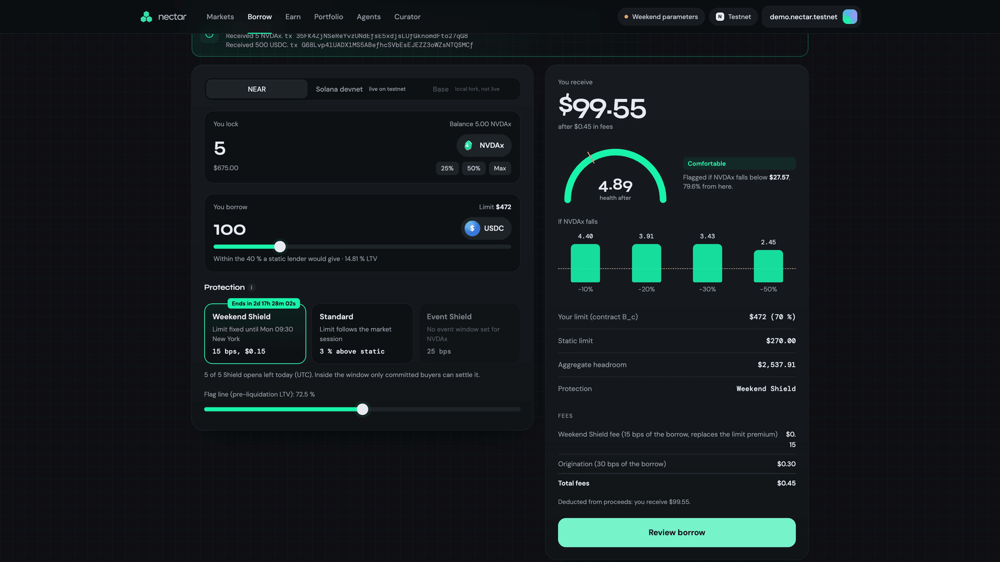
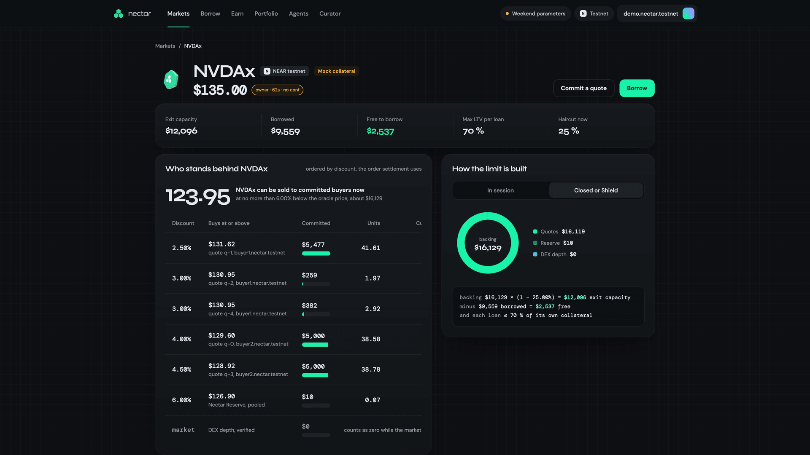
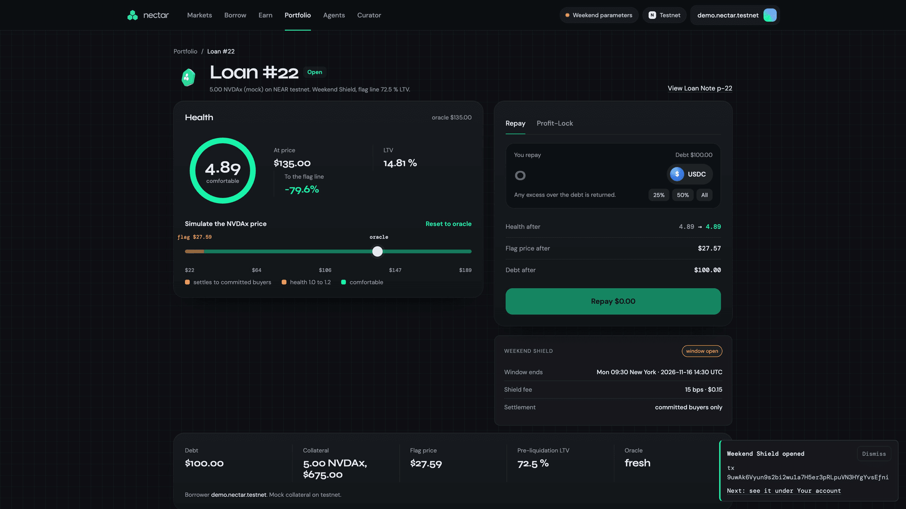
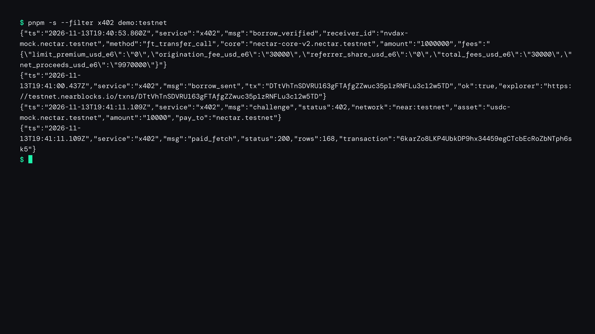
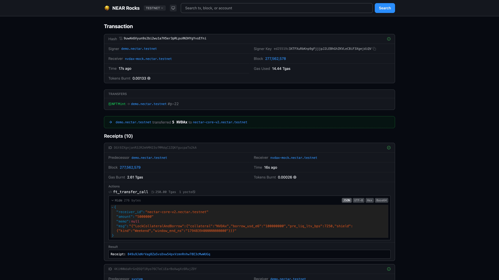
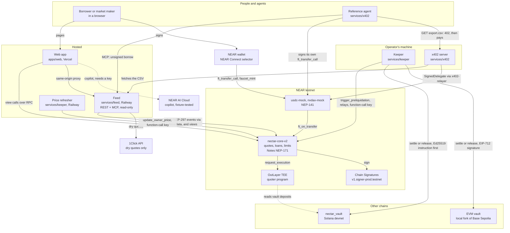

<p align="center">
  <picture>
    <source media="(prefers-color-scheme: dark)" srcset="packages/ui/logo/lockup-dark.png">
    
  </picture>
</p>

Nectar lets holders of tokenized stocks borrow USDC against a limit backed by market makers who have already escrowed USDC to buy the collateral. It runs on NEAR testnet with mock collateral.



Taken on 2026-11-13 just after the 16:00 New York close. Confirming this borrow opened loan #22 in [9uwAk6Vy…](https://testnet.nearblocks.io/txns/9uwAk6Vyun9s2bi2wu1a7H5er3pRLpuVN3HYgYvsEfni) at 21:02 UTC.

Lenders cap loans against tokenized stocks because the DEX liquidity they would sell into can disappear, most of all when the stock market is closed. Without a buyer they can count on, they set a low limit or sell early. In Nectar the buyer commits first: market makers escrow time-locked USDC buy quotes in a NEAR contract, the borrower's limit rests on those quotes, and an unhealthy loan's collateral goes to the committed buyer at a capped discount.

> Testnet only: NEAR testnet, plus Solana devnet for remote collateral. The collateral is mock NVDAx (`nvdax-mock.nectar.testnet`), standing in for tokenized equities such as xStocks, and the USDC is a mock too. Neither has any value. The market makers are our own demo accounts. No mainnet, no token, not audited.

Terms such as quote, limit, Shield, Standard, health, Feed and keeper are defined in the [Glossary](#glossary).

Submitted version: tag `submission-rc` (commit 36228da, plus this line).

## 60-second path

On https://testnet.nectarlabs.io with a NEAR testnet wallet that holds a little testnet NEAR for gas (https://near-faucet.io/):

| Do this | You should see |
| --- | --- |
| Open https://testnet.nectarlabs.io/feed/NVDAx | Exit capacity for mock NVDAx and the committed buyers behind it. At 2026-11-13T20:13Z, with the market open, the contract reported $16,119.22 of escrowed quotes, $14,516.30 of capacity and $4,957.30 of headroom; the page shows the current values. Once the market closes, the haircut rises to 25 % and DEX depth counts as $0, as in this screenshot from just after the close: $12,096 of capacity, $2,537 free to borrow <br> |
| Open /borrow, connect a wallet, click "Get test assets" | Your wallet approves two `faucet_mint` calls in one request: 5 mock NVDAx and 500 mock USDC (1 claim per hour, 3 per account). The notification links both transactions |
| Enter what you lock and what you borrow, then pick a protection | The limit, every fee and the loan's health before you sign. Weekend Shield is refused when the next market open is more than 65.5 h away (Friday during market hours); pick Standard then |
| Click "Review borrow", then "Confirm in wallet" | Your wallet asks you to approve `ft_transfer_call` on `nvdax-mock`, sending mock NVDAx to `nectar-core-v2`. Then the drawer says "Loan opened" with a "View loan #N" button. The notification may not include the transaction hash (with Intear it sometimes does not). If it does not, open your account on https://testnet.nearblocks.io: the newest `ft_transfer_call` to `nvdax-mock` is your borrow |
| Click "View loan #N" (example: https://testnet.nectarlabs.io/position/22) | The position page with a health gauge, a price simulator and, for a shielded loan, the Shield's window. Loan #22 is $100 against 5 mock NVDAx with a Weekend Shield until 2026-11-16 14:30 UTC, Open (read 2026-11-13T21:26Z) <br> |
| Agent: `pnpm --filter x402 demo:testnet`, with the Feed and the x402 server running ([services/x402/README.md](services/x402/README.md)) | The agent asks the Feed for an unsigned borrow, checks it, signs its own call, then fetches the paid CSV: HTTP 402, a 0.01 mock USDC payment, HTTP 200. Run of 2026-11-13T19:41Z: loan #20, 168 CSV rows. It needs the agent's testnet key, so it runs on the operator's machine <br> |

## How NEAR is used, concretely

Every NEAR transaction below returned final status `SuccessValue` on testnet archival RPC (`EXPERIMENTAL_tx_status`, re-checked 2026-11-13T20:12Z, and at 21:26Z for the Weekend Shield borrows 9uwAk6Vy… and 475VLHwE…). NearBlocks answers scripts with HTTP 403, so open the links in a browser.

1. **`nectar-core-v2.nectar.testnet` escrows the quotes and enforces each loan's limit** (Rust, near-sdk 5.30.1; `contract_version` is `2.2.1-v7`, read 2026-11-13T20:13Z). `get_exit_capacity` returns the escrowed quotes, the haircut, the shared capacity and the headroom. A loan that does not fit is refused: in [9ykovXkm…](https://testnet.nearblocks.io/txns/9ykovXkmV1MqUBsUkRDkMtfv3LS8ALqqn9f3dB5cxgn1) the contract emits `remote_loan_refused {position_id: 8, reason: aggregate_limit}` and refunds the reservation deposit.
2. **NEP-141 `ft_transfer_call` deposits.** Collateral and USDC enter only this way. In [E2suM2LC…](https://testnet.nearblocks.io/txns/E2suM2LC4ac2AE9TZ66AGY72ZDrBdu1Yz8pEnwAs65hz) `agent1` sends 1 mock NVDAx to `nvdax-mock`, and the contract opens loan #15 for $10 with a $0.03 origination fee. In [9uwAk6Vy…](https://testnet.nearblocks.io/txns/9uwAk6Vyun9s2bi2wu1a7H5er3pRLpuVN3HYgYvsEfni) (2026-11-13T21:02Z, market closed) `demo` sends 5 mock NVDAx with a `LockCollateralAndBorrow` message that asks for a Weekend Shield; the contract emits `shield_opened` (15 bps, $0.15, window ending 2026-11-16 14:30 UTC) and `position_opened` for loan #22: $100 of debt, $99.55 received.

   

3. **NEP-171 Position Notes.** Every quote and loan is an NFT in the collection "Nectar Position Notes" (`nft_metadata`, spec `nft-1.0.0`; 27 Notes at 2026-11-13T20:14Z). [GcHF75nW…](https://testnet.nearblocks.io/txns/GcHF75nWhNi1kVnQr5tZWFH1W4gA1LvQdGhH3NxH15mt) opens loan #4 and emits `nft_mint` of Note `p-4`. Transferring a Note with `nft_transfer` or `nft_transfer_call` moves the loan's rights: the new holder can self-settle and receives the collateral a full repay releases; the old holder can no longer self-settle or transfer it. Repay stays open to anyone, and the collateral still goes to the Note's holder. Tests: `v7_notes_self_settle_by_new_loan_owner`, `v7_notes_self_settle_old_owner_refused`, `v7_notes_transfer_owner_only`, `v7_notes_residual_collateral_goes_to_loan_note_owner` ([contracts/nectar-core/src/tests_notes.rs](contracts/nectar-core/src/tests_notes.rs)). For Solana and Base collateral the release still goes to the original depositor ([SECURITY.md](SECURITY.md), "What remains", item 12).
4. **NEP-297 events read by the Feed.** The contract logs `EVENT_JSON` with standard `nectar`, version `2.0.0`, for example `oracle_updated` in [De6aVqqN…](https://testnet.nearblocks.io/txns/De6aVqqNvfyemXtpuGP6quaUNcZgN2xP6cCXHXEwvfZG). The Feed reads them from Neardata blocks; test `real nectar-core-v2 (2.0.0) log lines` ([services/feed/test/v2-events.test.ts](services/feed/test/v2-events.test.ts)) ingests real testnet log lines. The hosted Feed's `/health` reported 278 events indexed and 0 blocks of lag at 2026-11-13T20:13Z.
5. **x402 with a NEP-366 `SignedDelegate`.** The agent signs a delegate action that calls `ft_transfer` on `usdc-mock` for 0.01 mock USDC; `x402-relayer.nectar.testnet` submits it: [6karZo8L…](https://testnet.nearblocks.io/txns/6karZo8LKP4UbkDP9hx34459egCTcbEcRoZbNTph6sk5) (2026-11-13T19:41Z). The same flow in an independent re-run: [4vW2tPF5…](https://testnet.nearblocks.io/txns/4vW2tPF5Gqemkm5uoafQE6eaXidSMSCuqLcDVMTTB77b) (2026-11-11).
6. **A price-bot key limited to `update_owner_price`.** [BHopF1cu…](https://testnet.nearblocks.io/txns/BHopF1cuKAMDFoCnKyNZPPKR3qVPgs5dYiKxx6jwWpao) adds a function-call key to `nectar.testnet` whose only allowed method is `update_owner_price` on `nectar-core-v2`, with a 5 NEAR allowance (still listed by `view_access_key_list` at 2026-11-13T20:13Z). Its first refresh: [De6aVqqN…](https://testnet.nearblocks.io/txns/De6aVqqNvfyemXtpuGP6quaUNcZgN2xP6cCXHXEwvfZG). At 2026-11-13T20:13Z the price was 58 s old. The refresher checks every 15 s and re-asserts the price once it is 60 s old inside NYSE session windows, or 6 h old outside them (`ops.oracle_refresher` in [packages/config/config.yaml](packages/config/config.yaml), scheduled until 2026-11-18 23:59 UTC). The contract accepts a price up to 120 s old for a borrow while the session is open and up to 86,400 s (24 h) while it is closed (`max_age_ns_session`, `max_age_ns_closed` in `get_config` at block 277568411, 2026-11-13T21:59Z), so while the refresher runs a borrow works at any hour. A session counts as open only while the price is under 900 s old (`SESSION_MAX_PRICE_AGE_NS` in [contracts/nectar-core/src/lib.rs](contracts/nectar-core/src/lib.rs)).
7. **OutLayer TEE quoter.** The keeper (function-call key only) calls `trigger_preliquidation`; the contract asks a hash-pinned OutLayer program for the discount, clamps it to the quote's cap and emits `settlement_signed`: [HrpQsuMW…](https://testnet.nearblocks.io/txns/HrpQsuMWQcTZZmDgFbqxk8Mk5A1ZzjgiHzJ2f9HYdy4u) (OutLayer request 16453). Attestation of an earlier request: [request 15148](https://testnet-api.outlayer.ai/attestations/by-request/15148). The TDX quote is not verified on chain.
8. **1Click quotes as read-only reference.** The Feed fetches `dry: true` quotes and never deposits, because NEAR Intents has no testnet. NVDAx has no 1Click route, so its DEX depth term is 0 (`d_usd_e6` `0` in `get_exit_capacity`, 2026-11-13T20:13Z).
9. **Chain Signatures for remote collateral.** The contract builds each release or settlement message (`NECTAR_SETTLE_V1|chain=solana-devnet|…` in the `settlement_signed` event of HrpQsuMW…) and `v1.signer-prod.testnet` signs it with a key derived per position. On Solana devnet the vault checks the signature before it pays the buyer: in [3cdcQru2…](https://explorer.solana.com/tx/3cdcQru2WH6dbN9qvqLsKVz5CppVikHSYEgbJF8WLS6DRwzECncHSM3f5ABSJXZ4EWSZoKSfhFFRwePgihL7pWJ6?cluster=devnet) the Ed25519 verify instruction runs first, then `nectar_vault` `Settle` (finalized, no error). The Base leg (secp256k1 key, EIP-712) ran only on a local fork of Base Sepolia, which has no public explorer; its round trip is recorded in [docs/EVIDENCE.md](docs/EVIDENCE.md).

## Deployed on testnet

Accounts (the NEAR ones answered `view_account` and the Solana ones `getAccountInfo` on 2026-11-13T20:12Z):

| Account | Role |
| --- | --- |
| [`nectar-core-v2.nectar.testnet`](https://testnet.nearblocks.io/address/nectar-core-v2.nectar.testnet) | the credit contract: quotes, loans, limits, Notes (version `2.2.1-v7`, code hash `3mv4LRm6…`) |
| [`nectar.testnet`](https://testnet.nearblocks.io/address/nectar.testnet) | owner; also holds the price refresher's function-call key (`update_owner_price` on `nectar-core-v2` only) |
| [`usdc-mock.nectar.testnet`](https://testnet.nearblocks.io/address/usdc-mock.nectar.testnet) | mock USDC (NEP-141, capped public `faucet_mint`) |
| [`nvdax-mock.nectar.testnet`](https://testnet.nearblocks.io/address/nvdax-mock.nectar.testnet) | mock NVDAx collateral (NEP-141, capped public `faucet_mint`) |
| [`keeper-v2.nectar.testnet`](https://testnet.nearblocks.io/address/keeper-v2.nectar.testnet) | keeper; its only key is a function-call key for 5 methods on `nectar-core-v2`: `trigger_preliquidation`, `relay_settlement_result`, `confirm_remote_deposit`, `keeper_attest_deposit`, `relay_release_result` |
| [`x402-relayer.nectar.testnet`](https://testnet.nearblocks.io/address/x402-relayer.nectar.testnet) | submits agents' signed x402 payments |
| [`agent1.nectar.testnet`](https://testnet.nearblocks.io/address/agent1.nectar.testnet) | the reference agent's account |
| [`buyer1.nectar.testnet`](https://testnet.nearblocks.io/address/buyer1.nectar.testnet), [`buyer2.nectar.testnet`](https://testnet.nearblocks.io/address/buyer2.nectar.testnet) | demo market-maker accounts |
| [`borrower1.nectar.testnet`](https://testnet.nearblocks.io/address/borrower1.nectar.testnet), [`demo.nectar.testnet`](https://testnet.nearblocks.io/address/demo.nectar.testnet) | demo borrowers (`demo` appears in the screenshots) |
| [`nectar-core.nectar.testnet`](https://testnet.nearblocks.io/address/nectar-core.nectar.testnet), [`keeper.nectar.testnet`](https://testnet.nearblocks.io/address/keeper.nectar.testnet) | first deployment, replaced by the two accounts above; still on chain |
| [`ENZaNFHo…pubW`](https://explorer.solana.com/address/ENZaNFHosYeNhsjC85K73feMFwX4w8i1dzuhQ3PzpubW?cluster=devnet) (Solana devnet) | `nectar_vault` program (executable, upgradeable loader) |
| [`3Ve8GiDB…E8hT`](https://explorer.solana.com/address/3Ve8GiDBtD7crfwUcKukpMigKQaU2aXtSCNgu661E8hT?cluster=devnet) (Solana devnet) | mock NVDAx mint on devnet (SPL Token, 6 decimals) |
| `v1.signer-prod.testnet`, `outlayer.testnet` | third parties: the Chain Signatures signer and OutLayer |

The Base vault runs on a local fork only; its addresses are in [packages/config/config.yaml](packages/config/config.yaml) under `base`.

Hosts (each answered HTTP 200 on 2026-11-13T20:13Z; hosted until at least 2026-11-25):

| Host | What |
| --- | --- |
| https://nectarlabs.io | site |
| https://testnet.nectarlabs.io | the app (redirects to /feed) |
| https://docs.nectarlabs.io | docs |
| https://status.nectarlabs.io | status |
| https://feed-production-2f2776c9.up.railway.app/health | Feed REST, read-only; holds contract events from block 277503800 on |

## What is real, what is mock

| Part | Status |
| --- | --- |
| Credit contract `nectar-core-v2.nectar.testnet` | real, NEAR testnet |
| Wallet connection | real NEAR testnet wallets (NEAR Connect selector) |
| Faucet ("Get test assets") | real `faucet_mint` on the mock tokens; capped, no value |
| Collateral | **mock** NVDAx (`nvdax-mock.nectar.testnet`), standing in for tokenized equities |
| USDC | **mock** (`usdc-mock.nectar.testnet`) |
| Market makers | our demo accounts (`buyer1`, `buyer2`) with quoter inputs we set, not independent market makers |
| Oracle | **owner oracle**: a price we set ($135.00 at 2026-11-13T20:13Z), re-asserted by a hosted bot whose key can call only `update_owner_price`: once the price is 60 s old inside NYSE session windows and 6 h old outside them, against contract limits of 120 s (session open) and 24 h (closed). A Pyth path is built and tested in the sandbox, not live |
| OutLayer quoter | real TEE execution on testnet; if the call fails, the contract settles at the quote's cap |
| Solana leg | real, Solana devnet + NEAR testnet signer |
| Base leg | **local fork** of Base Sepolia (chain id 84532), not Base Sepolia |
| Keeper and x402 server | real testnet accounts; run on the operator's machine, not hosted, not continuous |
| Feed | hosted REST + MCP, read-only |
| Copilot | built; tested on a recorded fixture only, no live NEAR AI answer verified |
| Site, app, docs, status | hosted on Vercel |

## What this does not prove

- Mainnet or real money: everything runs on NEAR testnet and Solana devnet.
- Real tokenized-equity liquidity: the collateral and USDC are mocks, and the quotes come from our own demo accounts.
- Safety: the code is not audited. Two internal reviews and what is still open are in [SECURITY.md](SECURITY.md).
- A market price: the owner oracle is a price we set; the price drops in the demo are ours.
- Base Sepolia: the EVM leg ran only on a local fork.
- On-chain TEE verification: the TDX quote is not checked on chain, and keeper reports of remote transactions are advisory.
- A loan held through a whole weekend: loans #22 and #24 opened on Friday 2026-11-13 after the close, and their Weekend Shield windows end on Monday 2026-11-16 at 14:30 UTC. No Weekend Shield window has yet run to its end on testnet.
- A live copilot answer, or an LLM agent using the Feed's MCP tools (only a scripted client has used them).
- Which commit each production deploy was built from: that is self-attested, and [docs/EVIDENCE.md](docs/EVIDENCE.md) says so where it applies.

## What we set out to prove, and the result

| Claim | Result | Evidence |
| --- | --- | --- |
| Escrowed quotes raise the borrow limit | at the 10% haircut, the $10 Reserve alone would give $9 of capacity; with $16,119.22 of escrowed quotes added, capacity is $14,516.30 | `get_exit_capacity {"symbol":"NVDAx"}` at block 277557669, 2026-11-13T20:13Z |
| Borrowers' premium pays the committed buyers | 70% of the limit premium goes to the buyers' side, split between the quotes and the Reserve in proportion to their backing; lenders get 20%, the treasury 10% | `get_config` `fee_split` at block 277558471 (2026-11-13T20:21Z); `split_premium_qr` in [contracts/nectar-core/src/lib.rs](contracts/nectar-core/src/lib.rs) |
| The limit holds across all loans | a loan beyond the shared capacity is refused and its reservation deposit refunded | [9ykovXkm…](https://testnet.nearblocks.io/txns/9ykovXkmV1MqUBsUkRDkMtfv3LS8ALqqn9f3dB5cxgn1) |
| A loan can open while the stock market is closed | loan #22 opened at 2026-11-13T21:02Z, after the New York close, while the contract counted DEX depth as $0 and applied a 25 % haircut: 5 mock NVDAx, $100 borrowed, $99.55 received, Weekend Shield at 15 bps ($0.15) until the next open (2026-11-16 14:30 UTC). Loan #24 followed at 21:06Z on the same terms | [9uwAk6Vy…](https://testnet.nearblocks.io/txns/9uwAk6Vyun9s2bi2wu1a7H5er3pRLpuVN3HYgYvsEfni) (`shield_opened`, `position_opened`), [475VLHwE…](https://testnet.nearblocks.io/txns/475VLHwE9Nvkgq2kc15NWVQJLDyLmvcyD2Y2fNAURF1W); `get_exit_capacity {"symbol":"NVDAx"}` at block 277562578 |
| The committed buyer takes the collateral, not a DEX | loan #10: the quoter priced quote 2 at 300 bps; the signed settlement repays $370.44 from the buyer's escrow and gives the buyer 2.386856 mock NVDAx from the Solana devnet vault | [6TKH53Xp…](https://testnet.nearblocks.io/txns/6TKH53XpeanuU1G2ekWAF1PFpxEKs3ZvXYFu3MVyZboP) (trigger and signature), [9s8HDeaq…](https://testnet.nearblocks.io/txns/9s8HDeaqRhP13ZPYvB3jn6uRLpTppjfdXVE8n6CRmU1a) (settlement reported); Solana side in [docs/EVIDENCE.md](docs/EVIDENCE.md) |
| The discount is computed verifiably and stays under the cap | 159 bps against a 400 bps cap, attested by OutLayer | [request 15148](https://testnet-api.outlayer.ai/attestations/by-request/15148) |
| Remote collateral moves only with a NEAR signature | the Solana vault verified the NEAR-signed message (Ed25519 instruction first) before it paid the buyer | [3cdcQru2…](https://explorer.solana.com/tx/3cdcQru2WH6dbN9qvqLsKVz5CppVikHSYEgbJF8WLS6DRwzECncHSM3f5ABSJXZ4EWSZoKSfhFFRwePgihL7pWJ6?cluster=devnet) |
| A loan's rights move with its Note | the new holder self-settles and receives the released collateral; the old holder is refused | tests in [contracts/nectar-core/src/tests_notes.rs](contracts/nectar-core/src/tests_notes.rs) (item 3 above) |
| An agent can borrow and pay for data on its own | $10 loan (#20) with a $0.03 fee, then 0.01 mock USDC paid: HTTP 402, then 200 with 168 CSV rows (2026-11-13T19:41Z) | [DTtVhTnS…](https://testnet.nearblocks.io/txns/DTtVhTnSDVRU163gFTAfgZZwuc35p1zRNFLu3c12w5TD), [6karZo8L…](https://testnet.nearblocks.io/txns/6karZo8LKP4UbkDP9hx34459egCTcbEcRoZbNTph6sk5), screenshot above |
| The price bot can do one thing only | its key may call `update_owner_price` on `nectar-core-v2` and nothing else | [BHopF1cu…](https://testnet.nearblocks.io/txns/BHopF1cuKAMDFoCnKyNZPPKR3qVPgs5dYiKxx6jwWpao) |

Every check, with commands, outputs and links: [docs/EVIDENCE.md](docs/EVIDENCE.md). Raw logs, including some transactions cited above that EVIDENCE does not repeat, are under evidence/; what each folder holds: [evidence/README.md](evidence/README.md).

## Next

This build becomes the cross-chain layer of Nectar, a protocol for credit sized to a sale arranged before the loan. NEAR coordinates settlement on Solana and Base through Chain Signatures and, when a lender or grant funds it, native BTC held under a NEAR-derived key. Before mainnet: real market makers on testnet, a production oracle and an audit.

## Architecture



One Rust contract, nectar-core-v2, holds the quote escrow, positions and limit math. It takes collateral through NEP-141 ft_transfer_call, emits NEP-297 events and records each loan as a NEP-171 Position Note. A Feed service indexes those events and serves REST and MCP, so agents can read limits and open loans signed with their own keys (so far a scripted agent); paid data uses x402 with NEP-366 meta-transactions. A price refresher holds a function-call key that can call only update_owner_price. Cross-chain settlement uses Chain Signatures; the Base leg is tested on a local fork of Base Sepolia.

Details:

- The contract is in [contracts/nectar-core](contracts/nectar-core). It also holds the pool and an O(1) fee index, mints a Note for each quote too, and refuses any token other than USDC or a configured collateral; tokens enter only through `ft_transfer_call` → `ft_on_transfer(msg)`.
- If a position breaks, a keeper triggers the sale and escrowed USDC repays the loan. The keeper passes ids and never prices or signs; the contract re-checks everything. On pre-liquidation the contract asks the pinned OutLayer program for the discount and clamps it to `[0, max_discount_bps]`; if the call fails, it settles at the cap. The same program reads the Solana vault to confirm remote deposits.
- The scripted agent is the reference agent in [services/x402](services/x402). The browser never calls the Feed host directly: the web app proxies a fixed list of read-only Feed paths.
- For remote collateral the contract builds the release or settlement message itself and gets a signature over the raw bytes from Chain Signatures, one derived key per position. The keeper only carries the signed message to the vault.

### Glossary

- **Quote**: a market maker's escrowed USDC offer to buy a set amount of collateral at no more than a capped discount. It can be withdrawn only after a notice period (7 days: `min_notice_period_ns` in `get_config`, read 2026-11-13T20:14Z).
- **Limit**: what one loan may borrow, `B_c = min(LTV_c·V_c, (1−h_c)(Q_c+R_c+D_c))`: the LTV cap on the collateral's value, or the haircut share of committed quotes `Q_c`, the Reserve `R_c` and DEX depth `D_c`, whichever is lower. At 2026-11-13T20:13Z it was $94.50 per mock NVDAx at a $135.00 price. When the market is closed, `D_c` is 0 and a larger haircut applies.
- **Exit capacity**: `(1−h_c)(Q_c+R_c+D_c)` for an asset, shared by all its loans; total debt must fit inside it. Headroom is capacity minus debt ($14,516.30 − $9,559.00 = $4,957.30 at 2026-11-13T20:13Z).
- **Shield**: protection paid at borrow time. A Weekend Shield (15 bps) sizes the loan at the weekend limit, and inside its window, which ends at the next market open, only committed buyers can settle it. An Event Shield (25 bps) covers an event window when one is set for the asset.
- **Standard**: the protection choice without a Shield; the loan's limit follows the market session (open or closed parameters).
- **Note**: the NEP-171 token minted for every quote (`q-<id>`) and loan (`p-<id>`). Its holder holds the authority over that quote or loan.
- **Health**: the loan's flag line divided by its current LTV; at 1 or above the loan is healthy, below 1 the keeper can trigger pre-liquidation (loan #22 showed 4.89).
- **Flag line**: the pre-liquidation LTV the borrower picks at borrow time, within the asset's bounds; the flag price is the collateral price at which health reaches 1.
- **Nectar Reserve**: one pooled committed buyer per asset that fills after the quotes; depositors put in USDC for shares, and its USDC is the `R_c` term of the limit.
- **Profit-Lock**: self-settlement (`self_settle`): a healthy borrower sells just enough collateral to opted-in committed buyers to repay the debt plus a 50 bps fee, and keeps the rest.
- **Keeper**: the bot in [services/keeper](services/keeper) that calls `trigger_preliquidation` and relays remote deposits, settlements and releases with a function-call key; it passes ids and never prices or signs.
- **Feed**: the read-only indexer in [services/feed](services/feed) of the contract's NEP-297 events and views, served as REST and MCP; it holds no keys.
- **x402**: an HTTP payment flow: the server answers 402 Payment Required with a price, the client pays (here 0.01 mock USDC through a NEP-366 `SignedDelegate`) and retries to get 200.
- **Intear**: a NEAR wallet offered in the NEAR Connect selector; the screenshots were taken with it.

## Repository layout

| Path | What it holds |
| --- | --- |
| [contracts/](contracts) | `nectar-core`, the hub contract on NEAR testnet; `mock-ft`, the mock NVDAx and USDC tokens; sandbox-only stubs and helper scripts |
| [apps/web](apps/web) | the web app, https://testnet.nectarlabs.io |
| [apps/docs-site](apps/docs-site) | the docs site (Docusaurus), https://docs.nectarlabs.io |
| [landing/](landing) | the static landing page design; the web app's home page is its React port |
| [packages/](packages) | `config` (account ids and parameters in `config.yaml`), `sdk` (the TypeScript SDK the web app uses), `ui` (design tokens, styles, fonts, logo) |
| [services/](services) | `keeper` (the keeper and the price refresher), `feed` (the read-only REST and MCP indexer), `x402` (the paid CSV server and the reference agent) |
| [quoter/](quoter) | the Rust program OutLayer runs in a TEE: the pre-liquidation discount and the Solana vault reads |
| [solana/](solana) | `nectar_vault`, the Anchor program on Solana devnet that holds remote collateral, with its client and tests |
| [evm/](evm) | the Foundry project for the EVM vault (`NectarVaultBase`), run only on a local fork of Base Sepolia |
| [scripts/](scripts) | numbered deploy, seed and gate scripts, the quick-start checks, deploy and demo tooling |
| [docs/](docs) | EVIDENCE, FACTS, RUNBOOK, SUBMISSION, the demo script and screenshots; [docs/process/](docs/process) holds the build log (work orders, state, decisions) |
| [evidence/](evidence) | raw logs behind docs/EVIDENCE.md ([index](evidence/README.md)) |

## Run locally

From a fresh clone, no keys needed. Node ≥ 22.22.2, pnpm 10.34.9. Timings are from a fresh-clone rehearsal from the public GitHub URL on 2026-11-13.

```bash
git clone https://github.com/NectarLabsio/nectar-labs.git && cd nectar-labs
pnpm i                         # 12 s
pnpm demo:testnet              # 4–40 s, depending on the RPC: read-only nectar-core-v2 views over public testnet RPC
pnpm verify                    # 36 s: lint, typecheck, unit tests, then the testnet views again
pnpm --filter web dev          # web app on http://localhost:3100, ready in 4 s
```

- `pnpm i` ends with "Ignored build scripts: core-js, secp256k1. Run pnpm approve-builds". That is expected; the quick start needs nothing approved.
- If `pnpm demo:testnet` or `pnpm verify` fails with HTTP 429, the default RPC (FastNear) is rate-limiting your IP. Use the NEAR RPC instead: `NEAR_RPC_URL=https://rpc.testnet.near.org pnpm demo:testnet` passed in 39 s on 2026-11-13.

| Command | What it does |
| --- | --- |
| `pnpm demo:testnet` | runs [scripts/50-verify.sh](scripts/50-verify.sh), which runs [scripts/demo-testnet.mjs](scripts/demo-testnet.mjs): it reads the ids from [packages/config/config.yaml](packages/config/config.yaml) and calls the contract's views over public RPC (default `https://test.rpc.fastnear.com`; override with `NEAR_RPC_URL`). It prints the contract version, NVDAx exit capacity and oracle age, the pool, the first 16 quotes, the first 16 loans (#0–#15, with LTV and pre-liquidation LTV in bps for open ones, from `get_health`) and explorer links. Both lists ask for `limit: 16` from index 0, so newer loans such as #22 are not listed. No keys, no near CLI |
| `pnpm verify` | lint, typecheck and unit tests across the workspace, then the testnet views |
| `pnpm --filter web dev` | the web app on http://localhost:3100 |
| `pnpm --filter docs-site build` | static docs build; a broken link fails it (24 s) |
| `pnpm --filter docs-site start` | docs on http://localhost:3000/ |
| `pnpm --filter feed start` | Feed REST on :8788 and MCP over HTTP at http://127.0.0.1:8789/mcp; no keys. With `FEED_DB_PATH` unset it writes its SQLite database to `~/.nectar/feed.sqlite` (creating the folder). To keep it in the clone, run `FEED_DB_PATH=./feed.sqlite pnpm --filter feed start`: pnpm runs the script from `services/feed`, so the file lands at `services/feed/feed.sqlite` ([services/feed/README.md](services/feed/README.md)) |
| `pnpm -s --filter feed mcp` | Feed MCP over stdio (read-only tools); reads the same `FEED_DB_PATH` database |
| `pnpm --filter x402 demo:testnet` | the reference agent; needs the agent's testnet key ([services/x402/README.md](services/x402/README.md)) |

- Locally, http://localhost:3100/ serves the landing page and the app routes start at http://localhost:3100/feed (the hosted app redirects / to /feed).
- Web pages: `/feed`, `/feed/NVDAx`, `/borrow`, `/quote/new`, `/console`, `/notes`, `/reserve`, `/shield`, `/agents`, `/keepers`, `/security`, `/talk`, `/docs`, `/legal/privacy` (also `cookies`, `terms`, `disclaimers`), and `/position/<id>`, `/quote/<id>`, `/note/<token id>` (for example `/note/q-0`).
- MCP tools: `get_exit_capacity`, `preview_borrow`, `list_quotes`, `explain_limit`, `quote_capacity`, `open_protected_stock_loan` (returns an unsigned call); `get_note` and `build_self_settle` return `not_available`. Arguments take `symbol`, for example `get_exit_capacity {"symbol":"NVDAx"}`. A raw HTTP client must send `accept: application/json, text/event-stream`.
- The keeper and the x402 server need testnet keys, which live in the OS keychain or `0600` files under `~/.nectar/`; see [services/keeper/README.md](services/keeper/README.md) and [services/x402/README.md](services/x402/README.md).
- More docs, including how this was built: [docs/README.md](docs/README.md).

## Known issues

- Two flag prices on the loan page: the "Flag price" figure and the Repay tab's "Flag price after" (before any amount is entered) can differ by a few cents, for example $27.59 and $27.57 on loan #22. Both round the loan-to-value to whole basis points: the contract rounds up (`ltv_bps` in [contracts/nectar-core/src/math.rs](contracts/nectar-core/src/math.rs)), the Repay tab rounds down. The higher figure comes from the contract.
- No transaction link after some borrows: with the Intear wallet, a borrow sent as one transaction returns no transaction hash to the app, so the success notification has no "View transaction" link, although the borrow steps say the link is there. The borrow is the latest `ft_transfer_call` to `nvdax-mock.nectar.testnet` on your account's explorer page, `https://testnet.nearblocks.io/address/<your account>`.

## Security

The code is testnet software with mock assets and has not been audited. Report vulnerabilities to kunal@nectarnetwork.fun with the subject `SECURITY: nectar-labs`; the policy, the two internal reviews and the known limitations still open are in [SECURITY.md](SECURITY.md).

## Prior work (disclosure)

Before the hackathon, Kunal researched exit-liquidity gaps for tokenized stocks under Nectar Network (an October 2026 product brief and
Stellar Community Fund #42 material). That research and the Nectar brand assets (logo, colour tokens) are the baseline. Nectar Network's separate Stellar testnet
product shares no code with this repository. All code, contracts, programs, services and sites here were written during the hackathon window, starting 2026-11-09.

## Libraries and services

Contracts and programs: near-sdk 5.30.1, near-workspaces 0.24.0 (sandbox tests), anchor-lang 0.32.1 (Solana vault), Foundry (EVM vault).
TypeScript: near-api-js 7.4.0, @solana/kit 8.6.0, viem 2.57.17, @hot-labs/near-connect 0.12.0, Next.js 16.4.5, React 19.3.1, Docusaurus 3.10.2, @modelcontextprotocol/sdk 1.32.2,
@x402/core and @x402/near 2.18.0, @fastnear/x402 2.5.0, @defuse-protocol/one-click-sdk-typescript 0.1.26, @phala/dcap-qvl 0.7.1, @noble/curves and @noble/hashes 2.2.0, zod 4.6.7, three 0.160.0.
Services used: NEAR testnet RPC (FastNear), Neardata, OutLayer, the NEAR Chain Signatures signer `v1.signer-prod.testnet`, the 1Click API (dry quotes only), Solana devnet RPC, Vercel, Railway.

## Team

Kunal.

## Links

Site https://nectarlabs.io · App https://testnet.nectarlabs.io · Docs https://docs.nectarlabs.io · Status https://status.nectarlabs.io · X https://x.com/nectarlabsio · Code https://github.com/NectarLabsio/nectar-labs

## License

MIT © 2026 Nectar Labs.
