# Nectar Labs: committed buyers, higher limits

> **Testnet software for the NEAR Hackathon (development closes 2026-11-14 23:59 UTC). The collateral is a mock token (`nvdax-mock`) standing in for tokenized equities (xStocks / Opening Bell). No mainnet, no real funds. Gates (docs/EVIDENCE.md, 2026-11-10): G1, G2, G3 PASS (P0) · G4 OutLayer PASS (2026-11-09T22:10Z, addendum 22:51Z) · G6 1Click depth PASS (22:58Z) · G5 oracle FALLBACK (disclosed): owner oracle in use · G7 PARTIAL: Chain Signatures signer side verified on NEAR; Solana vault since deployed on devnet, round trip pending · G8 copilot PASS (fixture, 23:56Z) · G9 pending.**

Lenders cap LTV on tokenized stocks because DEX exit liquidity is revocable. Nectar Labs makes exit liquidity
*committed*. Market makers escrow time-locked quotes (Pappus) on NEAR. Borrowers get a higher limit
(Cramér) for a premium that pays the buyers. Pre-liquidation then sells to the committed buyer at a bounded discount instead of a DEX:
`B_c = min(LTV_c·V_c, (1−h_c)(Q_c+R_c+D_c))` (PRD §4.2, decision D-009).

## Live on testnet (ids from `packages/config/config.yaml`; evidence in `evidence/G2/`, `evidence/G4/`, `evidence/G6/`, `evidence/G7/`, `evidence/upgrades/`)
| Component | Account / id | Kind | Status |
| --- | --- | --- | --- |
| nectar-core | [`nectar-core.nectar.testnet`](https://testnet.nearblocks.io/address/nectar-core.nectar.testnet) | contract, code_hash `CFTfzY4APx3fBsebqQ8SqcfLVVcShKe4TdD48Sapgi5t` | live (testnet). Upgraded three times in place: P0 → V1 with state migration, a V1 code-only upgrade (22:38Z), then the P2 code-only upgrade (2026-11-09T23:40Z, `evidence/upgrades/run-20261109T2340Z.log`). The G7 verifier rebuilt this hash from a fresh clone |
| mock USDC | [`usdc-mock.nectar.testnet`](https://testnet.nearblocks.io/address/usdc-mock.nectar.testnet) | **mock** NEP-141 | live (testnet) |
| mock NVDAx | [`nvdax-mock.nectar.testnet`](https://testnet.nearblocks.io/address/nvdax-mock.nectar.testnet) | **mock** collateral | live (testnet) |
| owner | [`nectar.testnet`](https://testnet.nearblocks.io/address/nectar.testnet) | deployer; sets params and the owner price | live (testnet) |
| keeper | [`keeper.nectar.testnet`](https://testnet.nearblocks.io/address/keeper.nectar.testnet) (one function-call key, 2 methods, no full-access key; D-012) | service | not running continuously (run locally) |
| OutLayer quoter | project `nectar.testnet/nectar-quoter`, version_key `3ce17749…6cc2` on `outlayer.testnet` | TEE program (F-040), hash-pinned in nectar-core | **live (testnet), G4 PASS.** The settlement discount is computed in the TEE from encrypted market-maker inputs. Request 15148 returned 159 bps against a 400 bps cap ([attestation JSON](https://testnet-api.outlayer.ai/attestations/by-request/15148); F-168, F-179). The inputs are **demo values**, and their plaintext passed through OutLayer's `/secrets/pubkey` endpoint before encryption (F-167). The secrets open only for And[signer keeper, caller nectar-core, wasm hash] (F-177, F-178). The TDX quote is not verified on-chain |
| settlement discount fallback | quote's `max_discount_bps` | **fallback** | used when the quoter fails or is denied. Request 15145 was denied and settled at the 400 bps cap with `quoter_fallback` (G4 addendum, run C). G4 run A shows the same path |
| oracle | owner oracle on nectar-core (`update_owner_price`) | **owner oracle (disclosed)**, badge in UI | in use for NVDAx. The Pyth path is built and sandbox-tested (`get_price_no_older_than` with staleness, confidence and band checks; F-173, D-015) but is not live. Hermes returns 401 without an API key (C-007, handoff H13), so `pyth-oracle.testnet` has no NVDA price. `price-oracle.testnet` does not serve NVDA (C-012). **G5: FALLBACK (disclosed).** Owner oracle (disclosed); current value: run `pnpm demo:testnet` |
| 1Click depth | `dry: true` quotes on the 1Click API (F-060) | read-only, signed quotes | **G6 PASS.** NVDAx has no 1Click route (F-063), so `D_c` = 0. The Feed shows signed dry-quote depth for a reference pair (wNEAR → USDC), with impact computed from base units at $500, $1,000 and $2,000. Nothing is ever deposited (Q-007) |
| Feed REST / MCP | local (`pnpm --filter feed start`) | read-only, no keys | built and runs locally; no public host. MCP tools: `get_exit_capacity`, `preview_borrow`, `list_quotes`, `explain_limit` |
| Chain Signatures signer | [`v1.signer-prod.testnet`](https://testnet.nearblocks.io/address/v1.signer-prod.testnet) (F-030, F-184) | third-party MPC signer; path `solana-devnet-v1`, domain 1 = Ed25519 | **live (testnet); NEAR side of G7 verified (2026-11-09T23:57Z).** nectar-core builds the settlement preimage from its own state, the signer signs the raw bytes (no pre-hash, D-016) and nectar-core emits `settlement_signed`. The signature verifies against the vault authority `ed25519:6QPGoVj8…S1tV`, which equals the signer's `derived_public_key` for (nectar-core.nectar.testnet, solana-devnet-v1) (F-036). Evidence: trigger tx [FCtApD2L…MHhe](https://testnet.nearblocks.io/txns/FCtApD2LMyPh9hEznyMuCrccvTHWqAhNH2eJ17agMHhe), position #6. The preimage names a **placeholder** Solana program id and a throwaway recipient; nothing was relayed to Solana |
| Solana `nectar_vault` | [`ENZaNFHosYeNhsjC85K73feMFwX4w8i1dzuhQ3PzpubW`](https://explorer.solana.com/address/ENZaNFHosYeNhsjC85K73feMFwX4w8i1dzuhQ3PzpubW?cluster=devnet) (devnet) | P2, Anchor program | **deployed; round trip pending G7.** Deployed with `init_vault(NVDAx)` on 2026-11-10 (`evidence/solana/deploy-20261110T124326Z.log`; not yet in docs/EVIDENCE.md). No settle or release transaction exists on devnet yet, so nothing on Solana has verified a NEAR signature. **G7: PARTIAL** |
| NEAR AI copilot | web app panel (`apps/web/lib/copilot/`) | P2; NEAR AI Cloud (F-070) | **built; no live NEAR AI answer has been verified yet.** Live mode needs key H7, and NEAR AI Cloud returned 500 on 2026-11-09 (F-078). The panel shows an answer only after the signature and attestation checks pass; otherwise it shows "unverified — hidden". Tests (`pnpm --filter web test:copilot`, `e2e/copilot.spec.ts`) run on a fixture built from a real Intel-signed sample TDX quote (Phala dcap-qvl sample, MIT) plus a chat signed by a throwaway key, not a NEAR AI recording; it correctly ends "unverified — hidden". Intel DCAP quote verification runs on the server (F-073); EIP-191 signer recovery and report_data/nonce checks run in the browser (F-075, F-076). **G8: PASS (fixture), 2026-11-09T23:56Z** |
| Mainnet, real xStocks, Reserve `R_c`, keeper bonds, DAO owner | — | **PROD-only** | not in this repo |

Demo state: snapshot at 2026-11-09T20:49Z (evidence/G2/demo-testnet-20261109T2049Z.log); the seed had a $50,000 pool, quote #0 for $10,000 at 250 bps,
quote #1 for $5,000 at 400 bps, and position #0 with 100 mock NVDAx and $11,250 debt (Cramér limit $11,250 vs $7,200 static LTV). The
**G4 settlement runs used up part of it**: positions were settled and quote #0 was consumed. A re-seed is pending. Snapshot at 2026-11-09T23:57Z (EVIDENCE §G7): position #6 is `Settling` because its signature was never relayed to Solana. Live state (price, `Q_c`, open positions) is not hard-coded here; current value: run `pnpm demo:testnet`. All tokens are mocks with no value.

## Quick start (5 commands, no keys needed)
```
git clone <repo-url> nectar-labs && cd nectar-labs   # repo URL TODO-H2 (private until published)
pnpm i                       # warm store: 9 s in the rehearsal; a cold machine takes longer
pnpm demo:testnet            # read-only nectar-core views over public testnet RPC
pnpm verify                  # lint + typecheck + unit tests, then the testnet views again
pnpm --filter web dev        # web app on http://localhost:3100
```
Optional:
```
pnpm --filter docs-site build   # static docs build (broken links fail the build)
pnpm --filter docs-site start   # docs dev server on http://localhost:3000
pnpm --filter feed start        # Feed REST on :8788, MCP over HTTP at http://127.0.0.1:8789/mcp; no env needed
pnpm -s --filter feed mcp          # Feed MCP over stdio (read-only tools; see services/feed/README.md)
```
What works today (2026-11-10): all five commands (the repo URL in the first one is TODO-H2). Rehearsal timings are in
[docs/EVIDENCE.md](docs/EVIDENCE.md): `pnpm i` 9 s on a warm pnpm store (a cold machine is slower), `pnpm verify` 39 s.
`pnpm demo:testnet` runs `scripts/50-verify.sh`, which runs `scripts/demo-testnet.mjs`: it reads the ids from `config.yaml`
and calls nectar-core views over public testnet RPC (no keys, no near CLI; override the RPC with `NEAR_RPC_URL`).
`pnpm --filter web dev` starts the web app on port 3100 (G3 PASS). Without `CORE_ACCOUNT_ID` the Feed does not poll the
contract and its MCP tools read the local Feed SQLite store; registering the MCP server with a client is described in
services/feed/README.md and the docs-site page "Feed MCP". Node ≥ 22.22.2, pnpm 10.34.9.

## v7 in progress (built and tested, not on testnet yet)
Nothing in this table is live on NEAR testnet, and the live rows above do not change. The v7 contract modules ship together in one new
contract, `nectar-core-v2.nectar.testnet`, which has not been created yet: it needs about 6–8 testnet NEAR (decision D-018, handoff H-NEAR-FAUCET).
Gates: G1 (v7) for the contract, then G2b for its deploy; G7 for the Solana round trip; G14 for x402. Test names are on each docs page.
| Module | Status | Docs page |
| --- | --- | --- |
| Aggregate borrowing limit (each loan within its LTV *and* total debt within the asset's shared capacity) | built + tested (unit, sandbox `aggregate_debt_two_borrowers_repay_settle`); testnet deployment pending (G1 v7 → G2b) | Concepts › Aggregate borrowing limit |
| Weekend Oracle Guard (fails closed: NYSE windows, price ≤ 900 s, owner can only force closed) | built + tested (sandbox `weekend_guard_calendar_stale_and_forced`); testnet deployment pending | Concepts › Weekend Oracle Guard |
| Corporate-action multiplier (raw units × M; no double M for feeds that include it, D-021) | built + tested (unit); testnet deployment pending; OutLayer multiplier job not built | Concepts › Corporate-action multiplier |
| Origination fee 30 bps, registered referrers (50%), `pay_to` + claimable USDC | built + tested (sandbox `pay_to_claimable_and_referrers`); testnet deployment pending | Concepts › Fee stack and referrals |
| Remote collateral lifecycle on Solana (reserve → deposit → attested confirm → settle or release; one derived key per position) | NEAR side built + tested (3 sandbox tests, `evidence/wo-21/`); testnet deployment pending. OutLayer vault-read job not built (stub in tests); keeper attestation is the labelled testnet fallback | Integrate › Remote collateral on Solana |
| Solana `nectar_vault` program | [`ENZaNFHosYeNhsjC85K73feMFwX4w8i1dzuhQ3PzpubW`](https://explorer.solana.com/address/ENZaNFHosYeNhsjC85K73feMFwX4w8i1dzuhQ3PzpubW?cluster=devnet): **deployed; round trip pending G7** | Protocol › Solana vault |
| Agent skill: MCP tools `open_protected_stock_loan` (returns an unsigned call), `quote_capacity`, `get_note`, `build_self_settle` | built + unit-tested on view fixtures (`pnpm --filter feed test`); runs locally with the Feed; `get_note` / `build_self_settle` return `not_available` | Integrate › Agent skill and x402 |
| x402 paid Feed export (0.01 mock USDC on `near:testnet`) | built + tested against a mocked facilitator and RPC (`pnpm --filter x402 test`); testnet settle pending G14 (relayer and agent accounts not created, H-NEAR-FAUCET) | Integrate › Agent skill and x402 |
| Shields, Profit-Lock, Position Notes, Nectar Reserve, Base Sepolia spoke | not built yet | — |

## 60-second architecture

- `nectar-core` (Rust, near-sdk 5.30.1) holds all state: quotes, positions, pool, O(1) fee index.
- Tokens enter only through `ft_transfer_call` → `ft_on_transfer(msg)`. Any token other than USDC or a configured collateral is refused.
- The limit comes from committed capacity and an oracle price, checked for freshness (120 s in session, 24 h when closed) and against a 1,500 bps band.
- The keeper holds a function-call key for `trigger_preliquidation` and `relay_settlement_result` only. It passes ids and never prices or signs.
- P1 (live on testnet): a hash-pinned OutLayer TEE program returns the clearing discount, clamped to `[0, max_discount_bps]`. If it fails, the contract settles at the cap.
- P2 (NEAR side live on testnet): the contract builds the settlement message itself and gets an Ed25519 signature over the raw bytes from Chain Signatures (D-016). A Solana program (`nectar_vault`, deployed on devnet) verifies that signature before it releases collateral; no devnet settle has run yet (G7 PARTIAL).

## How a settlement works

P0 (static): keeper trigger → the contract repays the debt from the buyer's escrow → collateral goes to the buyer at `max_discount_bps`.
P1 (live on testnet): the keeper's trigger asks OutLayer for the discount, and the contract clamps it and settles, or falls back to the cap. P2 (NEAR side live on testnet): the contract asks `v1.signer-prod.testnet` to sign the raw preimage (no pre-hash, D-016) and emits `settlement_signed`. The keeper's Solana relay and the vault's settle are built but have not run on devnet, so such a position stays `Settling` (see docs-site "Preimage format").

## Tracks and why
`defi`: a new credit primitive (committed exit liquidity as a limit input).
`security`: contract-built preimage, pinned TEE program, keeper with a function-call key only, oracle staleness and band checks.
`privacy`: market-maker parameters stay inside the TEE; the copilot shows an answer only after signature and attestation checks pass (G8 PASS on a fixture; no live NEAR AI answer verified yet: key H7 absent, NEAR AI Cloud 500 on 2026-11-09); analytics off by default and consent-gated; self-hosted fonts.
`agents` (Feed MCP: built, read-only) is entered only if it passes G9.

## Evidence
[docs/EVIDENCE.md](docs/EVIDENCE.md) records every gate with its commands, outputs and explorer links. Status on 2026-11-10: G0–G4 and G6 PASS, G8 PASS (fixture), G5 FALLBACK (disclosed; live Pyth waits on H13), G7 PARTIAL (NEAR signer side verified; Solana vault deployed on devnet 2026-11-10, round trip pending), G9 pending.
The docs site (`apps/docs-site`) carries the spec, and every protocol page has a "Verified against" line citing FACTS ids.

## Prior work (disclosure, Q-002 / Q-005): draft, approve TODO-H12
Nectar Network (Kunal Drall) published research on exit-liquidity gaps for tokenized stocks before the
hackathon (Oct 2026 product brief; SCF #42 material). That research is the baseline. All code,
contracts, programs, services and sites in this repository were written during the hackathon window (from 2026-11-09).

## Roadmap
P0 core credit (G0–G3) → P1 TEE pricing, live oracle, 1Click depth, Feed MCP (G4–G6) → P2 Solana leg via Chain Signatures, copilot (G7–G8) → G9 fresh-clone rehearsal.
PROD (not here): mainnet with a DAO owner and timelock, audit, real tokenized-equity collateral.
Deliberately not built: other chains, a token, governance UI, mobile.

## Team
Kunal Drall (Nectar Network). Team list pending confirmation (TODO-H10).

## License
MIT © 2026 Nectar Network
