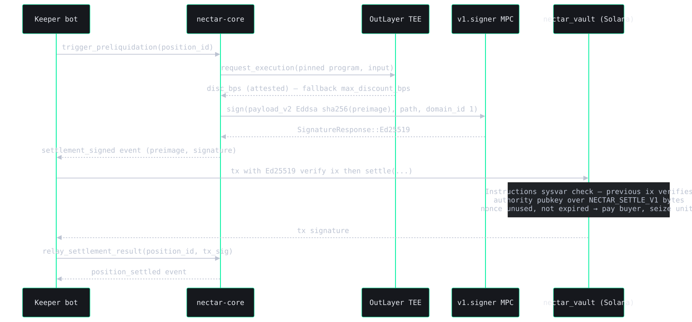

# Nectar Labs — committed buyers, higher limits

> **Testnet software for the NEAR Hackathon 2026. Collateral is a mock token (`nvdax-mock`) standing in for tokenized equities. No mainnet, no real funds.**

Lenders cap LTV on tokenized stocks because DEX exit liquidity is revocable. Nectar Labs makes exit
liquidity *committed*: market makers escrow time-locked quotes (Pappus) on NEAR, borrowers get a higher
limit (Cramér) for a premium that pays the buyers, and pre-liquidation sells to the committed buyer at a
TEE-computed discount instead of a DEX.

## Live on testnet (updated at G2 — see docs/EVIDENCE.md)
| Component | Account / id | Status |
| --- | --- | --- |
| nectar-core | `TODO-G2` → [explorer](https://testnet.nearblocks.io/address/TODO-G2) | live |
| mock USDC / mock NVDAx | `TODO-G2` / `TODO-G2` | **mock** (testnet only) |
| keeper | `TODO-G2` (function-call key) | live |
| OutLayer quoter | project `TODO-G4`, sha256 `TODO-G4` | P1 — fallback: static `max_discount_bps` |
| oracle | `TODO-G5` | P1 — fallback: owner oracle (badge shown) |
| Solana nectar_vault | `TODO-G7` (devnet) | P2 |
| NEAR AI copilot | fixture-verified; live needs key (H7) | P2 |

## Quick start (5 commands, no keys needed)
```
git clone <repo> && cd nectar-labs
pnpm i
pnpm demo:testnet            # read-only views against the live testnet contract
pnpm --filter web dev        # http://localhost:3000
pnpm --filter docs-site start
```

## 60-second architecture

nectar-core holds all state. Tokens enter through `ft_transfer_call` → `ft_on_transfer(msg)`. The contract
computes limits from committed capacity and an oracle price, flags unhealthy positions, asks a pinned
OutLayer program for the clearing discount (P1), builds the settlement message itself and asks Chain
Signatures for an Ed25519 signature (P2); a Solana program verifies that signature before releasing
collateral. The keeper passes ids and relays; it never prices or signs for funds.

## How a settlement works


## Tracks
`defi` (new credit primitive) · `security` (contract-built preimage, pinned TEE program, keeper with
function-call key only, oracle staleness/conf checks) · `privacy` (market-maker parameters stay inside
the TEE; copilot answers are TEE-signed and verified in the browser) · `agents` (Feed MCP) if G9 passes.

## Evidence
See [docs/EVIDENCE.md](docs/EVIDENCE.md): every gate with commands, outputs and explorer links.

## Prior work (disclosure, Q-002 / Q-005) — draft, approve: TODO-H12
Nectar Network (Kunal Drall) published research on exit-liquidity gaps for tokenized stocks before the
hackathon (Oct 2026 product brief; SCF #42 material). That research is the baseline. All code,
contracts, programs, services and sites in this repository were written during the hackathon window.

## What is deliberately not here
Mainnet, a token, governance UI, other chains, real tokenized equities (no route on testnet).

## License
MIT © 2026 Nectar Network
